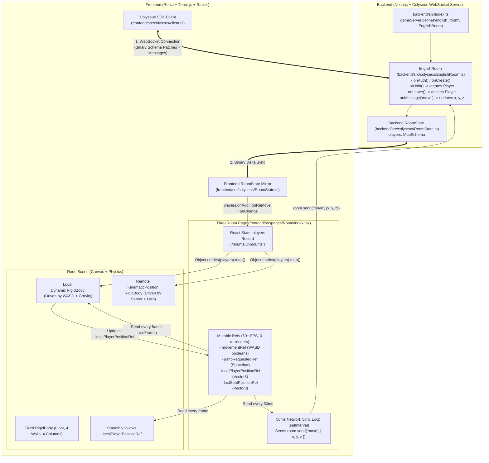
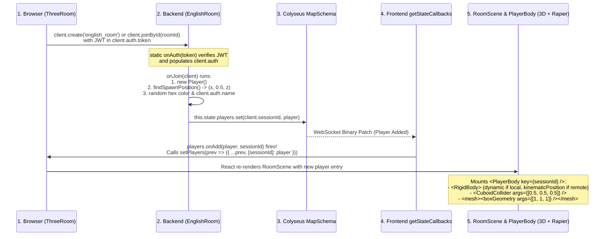
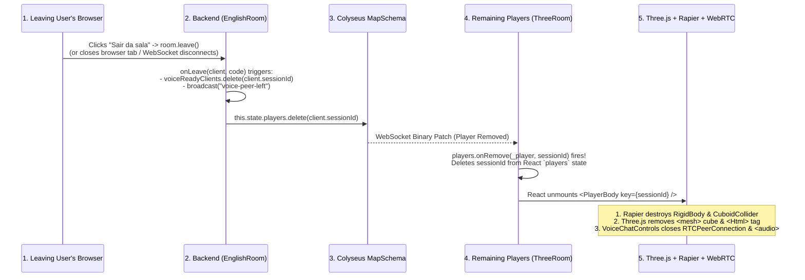
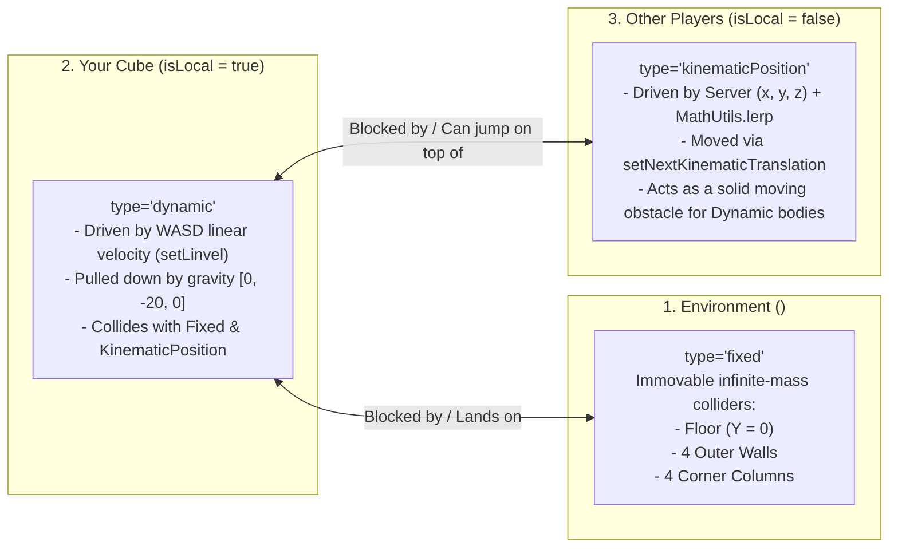
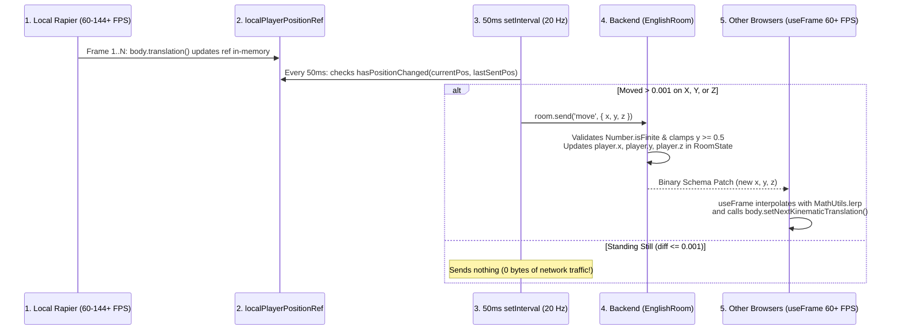

# Complete Guide: How 3D (Three.js + Rapier) and WebSockets (Colyseus) Work Together

This document explains **everything** about how the 3D scene and the WebSocket multiplayer layer work together in this project, covering:

1. **System Architecture & Data Flow** (Backend Colyseus ↔ React State & Refs ↔ Three.js & Rapier Physics)
2. **The Shared Binary State (`RoomState` & `Player` Schema)**
3. **How a Cube Is Created When a User Enters the Room** (End-to-End Spawn Lifecycle)
4. **How a Cube Is Deleted When a User Leaves the Room** (End-to-End Despawn & Cleanup Lifecycle)
5. **How Movement & Physics Work** (WASD Input, Jump & Ground Detection, Collision Resolution, Follow Camera, Network Throttling, and Remote Interpolation)
6. **How 3D Positions Power Proximity Voice Chat** (WebSocket Signaling + WebRTC + 3D Distance Attenuation)

---

## 1. High-Level Architecture: How 3D and WebSockets Connect

In a real-time 3D multiplayer app, two systems run at different speeds and have different responsibilities:

- **The 3D & Physics Engine (`@react-three/fiber` + `@react-three/rapier`)** runs locally in the browser at **60 to 144+ FPS** (`useFrame`). It needs immediate access to keyboard input and positions every single frame without waiting for network round-trips or slow React re-renders.
- **The WebSocket Multiplayer Engine (`Colyseus`)** connects all browsers to the Node.js server ([`EnglishRoom`](file:///home/pedrovidal/rooms/backend/src/colyseus/EnglishRoom.ts)). It synchronizes who is in the room (`onJoin` / `onLeave`) and broadcasts position updates (`move` messages → binary state patches) **20 times per second (every 50ms)**.

### Full Architecture Diagram



---

## 2. The Shared Binary State (`RoomState` & `Player`)

Instead of sending bulky JSON strings (`JSON.stringify({ x, y, z })`) over WebSockets, Colyseus uses `@colyseus/schema` to encode state changes into **compact binary patches (deltas)**. Only the exact bytes that changed are transmitted over the wire.

For the server to encode these bytes and the browser to decode them, **both sides define the exact same schema**:

1. **Backend Schema ([`backend/src/colyseus/RoomState.ts`](file:///home/pedrovidal/rooms/backend/src/colyseus/RoomState.ts#L1-L15)):**
   ```ts
   import { Schema, type, MapSchema } from "@colyseus/schema";

   export class Player extends Schema {
     @type("number") x: number = 0;
     @type("number") y: number = 0.5;
     @type("number") z: number = 0;
     @type("string") color: string = "#ffffff";
     @type("string") name: string = "";
   }

   export class RoomState extends Schema {
     @type({ map: Player }) players = new MapSchema<Player>();
     @type("string") roomName: string = "";
     @type("number") maxClients: number = 8;
   }
   ```

2. **Frontend Schema ([`frontend/src/colyseus/RoomState.ts`](file:///home/pedrovidal/rooms/frontend/src/colyseus/RoomState.ts#L1-L29)):**
   ```ts
   import { Schema, MapSchema, defineTypes } from "@colyseus/schema";

   export class Player extends Schema {
     x = 0;
     y = 0.5;
     z = 0;
     color = "#ffffff";
     name = "";
   }

   defineTypes(Player, {
     x: "number",
     y: "number",
     z: "number",
     color: "string",
     name: "string",
   });

   export class RoomState extends Schema {
     players = new MapSchema<Player>();
     roomName = "";
     maxClients = 8;
   }

   defineTypes(RoomState, {
     players: { map: Player },
     roomName: "string",
     maxClients: "number",
   });
   ```

| Property | Type | Meaning |
| :--- | :--- | :--- |
| `players` | `MapSchema<Player>` | Dictionary of active players in the room. The **key** is the Colyseus `client.sessionId` (unique per WebSocket connection) and the **value** is the `Player` instance. |
| `player.x`, `player.y`, `player.z` | `number` | 3D world coordinates of the center of the player's `1×1×1` cube (`y = 0.5` rests flush on the `y = 0` floor). |
| `player.color` | `string` | Random hex color (`#rrggbb`) generated by the server when the user joins. |
| `player.name` | `string` | Authenticated user's display name (or email fallback) extracted from the JWT token on the server. |

---

## 3. How We Create a Cube When a User Enters the Room

When a user enters a room (either by creating a new room or joining an existing one), **6 sequential steps** happen across the frontend and backend to spawn their 3D cube on everyone's screen:



### Step 1: Frontend Initiates the WebSocket Connection
In [`frontend/src/pages/Room/index.tsx`](file:///home/pedrovidal/rooms/frontend/src/pages/Room/index.tsx#L90-L115), the `useEffect` hook attaches the user's JWT token and requests a room connection using the Colyseus [`client`](file:///home/pedrovidal/rooms/frontend/src/colyseus/client.ts):

```ts
client.auth.token = localStorage.getItem(AUTH_TOKEN_STORAGE_KEY) ?? "";

if (createNewRoom || !initialRoomId) {
  room = await client.create(
    'english_room',
    {
      roomName: createState.roomName,
      maxClients: createState.maxClients ?? 8,
    },
    RoomState,
  );
  redirect(`/room/${room.roomId}`, { replace: true });
} else {
  room = await client.joinById(initialRoomId, {}, RoomState);
}
```
1. Behind the scenes, `@colyseus/sdk` sends an HTTP `POST` matchmaking request to reserve a seat in the room.
2. It then opens a dedicated WebSocket connection to that specific room instance (`ws://localhost:8080/<processId>/<roomId>?sessionId=...`).

### Step 2: Backend Authenticates the User (`onAuth`)
Before allowing the WebSocket handshake to join the room, [`EnglishRoom.onAuth`](file:///home/pedrovidal/rooms/backend/src/colyseus/EnglishRoom.ts#L31-L33) runs:
```ts
static async onAuth(token: string) {
  return verifyRoomToken(token);
}
```
[`verifyRoomToken`](file:///home/pedrovidal/rooms/backend/src/middlewares/authMiddleware.ts) validates the JWT and returns the decoded user payload (`{ id, name, email }`), which Colyseus automatically attaches to `client.auth`.

### Step 3: Backend Spawns the `Player` in `onJoin`
Once the WebSocket connects, Colyseus calls [`onJoin(client, options)`](file:///home/pedrovidal/rooms/backend/src/colyseus/EnglishRoom.ts#L119-L130) inside [`EnglishRoom.ts`](file:///home/pedrovidal/rooms/backend/src/colyseus/EnglishRoom.ts):

```ts
onJoin(client: Client, options: any) {
  const player = new Player();
  const spawn = this.findSpawnPosition();

  player.x = spawn.x;
  player.y = groundedY; // 0.5
  player.z = spawn.z;
  player.color = "#" + Math.floor(Math.random() * 16777215).toString(16).padStart(6, "0");
  player.name = client.auth?.name || client.auth?.email || "";

  this.state.players.set(client.sessionId, player);
}
```

#### How `findSpawnPosition()` avoids spawning inside another cube:
In [`EnglishRoom.ts`](file:///home/pedrovidal/rooms/backend/src/colyseus/EnglishRoom.ts#L145-L169), the server tries up to 20 random `(x, z)` coordinates between `-8` and `+8` (`spawnHalfRange = 8`, safely inside the `20×20` arena floor):
```ts
private canSpawnAt(x: number, z: number) {
  for (const otherPlayer of this.state.players.values()) {
    const overlapX = Math.abs(otherPlayer.x - x) < playerHalfSize * 2; // < 1.0m
    const overlapZ = Math.abs(otherPlayer.z - z) < playerHalfSize * 2; // < 1.0m

    if (overlapX && overlapZ) {
      return false;
    }
  }
  return true;
}
```
Once a free spot is found, `this.state.players.set(client.sessionId, player)` inserts the player into the synchronized `MapSchema`.

### Step 4: Frontend `players.onAdd` Bridges Colyseus to React State
Why doesn't React automatically know when `room.state.players` changes?
Because Colyseus mutates `room.state.players` in-place when binary patches arrive over the WebSocket, whereas React only re-renders when `setState` is called.

In [`frontend/src/pages/Room/index.tsx`](file:///home/pedrovidal/rooms/frontend/src/pages/Room/index.tsx#L126-L156), we use `getStateCallbacks(room)` to listen for entries added to `room.state.players`:

```ts
const stateCallbacks = getStateCallbacks(room);

stateCallbacks(room.state).players.onAdd((player: Player, playerSessionId: string) => {
  // If this added player is YOU (the local client):
  if (playerSessionId === room.sessionId) {
    localPlayerPositionRef.current.set(player.x, player.y, player.z);
    lastSentPositionRef.current.set(player.x, player.y, player.z);
    hasLocalSpawnedRef.current = true;
  }

  // Add the player to React state so <RoomScene> renders a <PlayerBody />
  setPlayers((prev) => ({ ...prev, [playerSessionId]: player }));

  // Listen for future property changes (x, y, z, color, name) on remote players
  stateCallbacks(player).onChange(() => {
    if (playerSessionId !== room.sessionId) {
      setPlayers((prev) => ({ ...prev, [playerSessionId]: player }));
    }
  });
});
```

> [!IMPORTANT]
> **`players.onAdd` fires in two situations:**
> 1. **Immediately when you join the room**, it fires once for **every player already inside the room** (including yourself).
> 2. **Later in real time**, whenever **a new player joins** the room after you.

### Step 5: `RoomScene` Maps Over `players` and Mounts `<PlayerBody>`
In [`frontend/src/pages/Room/components/RoomScene/index.tsx`](file:///home/pedrovidal/rooms/frontend/src/pages/Room/components/RoomScene/index.tsx#L43-L57), every entry in the `players` React state object is rendered as a `<PlayerBody>` inside the `<Physics>` world:

```tsx
{Object.entries(players).map(([playerSessionId, player]) => (
  <PlayerBody
    key={playerSessionId}
    sessionId={playerSessionId}
    player={player}
    isLocal={playerSessionId === sessionId}
    movementRef={movementRef}
    jumpRequestedRef={jumpRequestedRef}
    onLocalPositionChange={(position) => {
      if (playerSessionId === sessionId) {
        localPlayerPositionRef.current.copy(position);
      }
    }}
  />
))}
```

### Step 6: `<PlayerBody>` Creates the Rapier Physics Body & Three.js 3D Cube
Inside [`frontend/src/pages/Room/components/PlayerBody/index.tsx`](file:///home/pedrovidal/rooms/frontend/src/pages/Room/components/PlayerBody/index.tsx#L32-L141):

1. **Captures Initial Spawn Coordinates Once:**
   ```ts
   const [initialPosition] = useState<[number, number, number]>(() => [
     player.x,
     player.y,
     player.z,
   ]);
   ```
   Storing `initialPosition` in `useState` ensures that subsequent React re-renders do not reset the `<RigidBody position={initialPosition}>` prop and snap the physics body back.
2. **Creates the Physics Body, Collider, 3D Cube Mesh, and Nametag:**
   ```tsx
   <RigidBody
     ref={bodyRef}
     type={isLocal ? "dynamic" : "kinematicPosition"}
     colliders={false}
     position={initialPosition}
     enabledRotations={[false, false, false]}
     enabledTranslations={[true, true, true]}
     ccd={isLocal}
   >
     {/* 1. Physical hitbox: half-extents [0.5, 0.5, 0.5] = 1x1x1 meter box */}
     <CuboidCollider
       args={[playerHalfSize, playerHalfSize, playerHalfSize]}
       friction={0}
     />

     {/* 2. Visual 3D Cube: 1x1x1 box with the player's hex color */}
     <mesh castShadow receiveShadow userData={{ sessionId }}>
       <boxGeometry args={[1, 1, 1]} />
       <meshStandardMaterial color={color} />
     </mesh>

     {/* 3. Floating HTML Nameplate (only shown above OTHER players' cubes) */}
     {!isLocal && playerName && (
       <Html position={[0, playerNameOffsetY, 0]} center zIndexRange={[5, 0]} style={{ pointerEvents: "none" }}>
         <div>{playerName}</div>
       </Html>
     )}
   </RigidBody>
   ```

---

## 4. How We Delete a Cube When a User Leaves the Room

When a user leaves the room (by clicking **"Sair da sala"**, navigating back, or closing the browser tab), **5 sequential steps** remove their cube, physics collider, and voice stream from every remaining player's client:



### Step 1: Frontend Closes the Room Connection
When the user clicks **"Sair da sala"** in [`RoomHud`](file:///home/pedrovidal/rooms/frontend/src/pages/Room/components/RoomHud/index.tsx#L50-L65), `handleLeaveRoom()` navigates back to `'/'`, which unmounts [`ThreeRoom`](file:///home/pedrovidal/rooms/frontend/src/pages/Room/index.tsx#L178-L187) and runs the `useEffect` cleanup function:

```ts
return () => {
  detached = true;
  hasLocalSpawnedRef.current = false;
  roomRef.current = null;
  setRoomInstance(null);
  setSessionId(null);
  if (room) {
    room.leave();
  }
};
```
Calling `room.leave()` sends a clean WebSocket close frame to the Colyseus server. (If the user abruptly closes the browser tab or loses internet, the underlying WebSocket connection drops and Colyseus detects the disconnect automatically).

### Step 2: Backend Deletes the Player in `onLeave`
In [`backend/src/colyseus/EnglishRoom.ts`](file:///home/pedrovidal/rooms/backend/src/colyseus/EnglishRoom.ts#L132-L136), Colyseus invokes `onLeave`:

```ts
onLeave(client: Client, code: number) {
  this.voiceReadyClients.delete(client.sessionId);
  this.state.players.delete(client.sessionId);
  this.broadcast("voice-peer-left", { sessionId: client.sessionId }, { except: client });
}
```
- `this.state.players.delete(client.sessionId)` removes the player entry from the `MapSchema<Player>`.
- Colyseus automatically encodes a binary **delete patch** and sends it to all remaining clients in the room.
- **What if that player was the last person in the room?**
  By default, Colyseus rooms have `autoDispose = true`. When the last client leaves (`clients.length === 0`), Colyseus automatically calls [`onDispose()`](file:///home/pedrovidal/rooms/backend/src/colyseus/EnglishRoom.ts#L138-L143), which removes `this.normalizedRoomName` from `EnglishRoom.activeRoomNames` (freeing the room name for reuse) and notifies the `LobbyRoom` (`"-"`) so the room card disappears from the menu.

### Step 3: Remaining Clients Receive `players.onRemove`
In [`frontend/src/pages/Room/index.tsx`](file:///home/pedrovidal/rooms/frontend/src/pages/Room/index.tsx#L158-L164), the `onRemove` listener fires on the browser of every player still in the room:

```ts
stateCallbacks(room.state).players.onRemove((_player: Player, playerSessionId: string) => {
  setPlayers((prev) => {
    const nextState = { ...prev };
    delete nextState[playerSessionId];
    return nextState;
  });
});
```

### Step 4: React Unmounts `<PlayerBody>` (3D + Physics + Audio Cleanup)
Because `playerSessionId` was deleted from the `players` state object:
1. **React Three Fiber** unmounts `<PlayerBody key={playerSessionId} />`, removing the `<mesh>` (3D cube) and `<Html>` (nametag) from the Three.js scene graph.
2. **`@react-three/rapier`** automatically unregisters and frees the `<RigidBody>` and `<CuboidCollider>` from the Rapier WebAssembly physics world during component unmount, so no "ghost collider" remains in the arena.
3. **[`VoiceChatControls`](file:///home/pedrovidal/rooms/frontend/src/pages/Room/components/VoiceChatControls/index.tsx#L276-L290)** detects both the `"voice-peer-left"` message and the change in `players` keys, closing the WebRTC `RTCPeerConnection` and removing the hidden `<audio>` element for that peer.

---

## 5. How Movement Works (Physics, Controls, Collisions & Sync)

Movement in this project uses a **Client-Authoritative Local Physics + Server State Replication** model. Here is why and how every piece works:

### 5.1. Why Are There 3 Different `RigidBody` Types in the Scene?

Inside `<Physics gravity={[0, -20, 0]} colliders={false} timeStep="vary" interpolate>` in [`RoomScene/index.tsx`](file:///home/pedrovidal/rooms/frontend/src/pages/Room/components/RoomScene/index.tsx#L40-L58), every physical object uses one of three Rapier body types:



| Object | `RigidBody` Type | How It Moves | Why This Type? |
| :--- | :--- | :--- | :--- |
| **Arena** ([`Arena/index.tsx`](file:///home/pedrovidal/rooms/frontend/src/pages/Room/components/Arena/index.tsx#L21)) | `"fixed"` | Never moves | Floor, walls, and columns have infinite mass and block the player. |
| **Local Player** (`isLocal === true`) | `"dynamic"` | `body.setLinvel({ x: vx, y: nextVy, z: vz })` | Gives **0ms input latency** at 60+ FPS, real gravity, and automatic collision resolution against walls, columns, and other players. |
| **Remote Players** (`isLocal === false`) | `"kinematicPosition"` | `body.setNextKinematicTranslation(lerpedPos)` | Their position is controlled by the remote player's browser via the server. Making them `"kinematicPosition"` prevents local gravity from pulling them out of sync while still making them **solid 3D obstacles** you can collide with or jump on top of! |

---

### 5.2. Step-by-Step: Local Player Movement (`WASD` + `Space`)

#### Step A: Capturing Keyboard Input Without Re-rendering React ([`useHotkeys.tsx`](file:///home/pedrovidal/rooms/frontend/src/pages/Room/hooks/useHotkeys.tsx))
When you press or release `W`, `A`, `S`, `D` or `Space`, we **never** call React `useState` (which would re-render the entire component tree on every keystroke). Instead, [`useHotkeys`](file:///home/pedrovidal/rooms/frontend/src/pages/Room/hooks/useHotkeys.tsx#L16-L77) mutates `useRef` objects directly:

```ts
const updateMovement = (code: string, pressed: boolean) => {
  switch (code) {
    case 'KeyW':
      movementRef.current.forward = pressed;
      break;
    case 'KeyS':
      movementRef.current.backward = pressed;
      break;
    case 'KeyA':
      movementRef.current.left = pressed;
      break;
    case 'KeyD':
      movementRef.current.right = pressed;
      break;
  }
};
```
- **Pressing `Space`** (ignoring held key auto-repeat via `!event.repeat`) sets `jumpRequestedRef.current = true`.
- **Window `blur` safety listener:** If you are holding `W` and switch browser tabs or click outside the window (`window.addEventListener('blur', resetMovement)`), all four directions are reset to `false` so your cube doesn't keep walking forever.

#### Step B: Converting Input to Horizontal Velocity ([`PlayerBody/helpers.ts`](file:///home/pedrovidal/rooms/frontend/src/pages/Room/components/PlayerBody/helpers.ts))
In Three.js, the camera looks toward `-Z` (north), `+Z` is backward (south), `-X` is left (west), and `+X` is right (east).
[`computeHorizontalVelocity`](file:///home/pedrovidal/rooms/frontend/src/pages/Room/components/PlayerBody/helpers.ts#L8-L22) converts the active keys into velocity in meters per second (`playerMoveSpeed = 4.5` in [`PlayerBody/consts.ts`](file:///home/pedrovidal/rooms/frontend/src/pages/Room/components/PlayerBody/consts.ts#L2)):

```ts
export const computeHorizontalVelocity = (
  movement: MovementState | undefined,
): { vx: number; vz: number } => {
  if (!movement) {
    return { vx: 0, vz: 0 };
  }

  const dirX = Number(movement.right) - Number(movement.left);       // -1, 0, or +1
  const dirZ = Number(movement.backward) - Number(movement.forward); // -1, 0, or +1

  return {
    vx: dirX * playerMoveSpeed, // e.g., +4.5 m/s
    vz: dirZ * playerMoveSpeed, // e.g., -4.5 m/s
  };
};
```
*(Notice: if you hold both `A` and `D` simultaneously, `Number(true) - Number(true) = 1 - 1 = 0`, canceling out cleanly. And as soon as you release all keys, `vx` and `vz` become `0`, stopping the cube immediately without sliding).*

#### Step C: Jump Validation via Rapier Shape-Casting ([`PlayerBody/index.tsx`](file:///home/pedrovidal/rooms/frontend/src/pages/Room/components/PlayerBody/index.tsx#L53-L74))
Inside the 60+ FPS `useFrame` loop of [`PlayerBody/index.tsx`](file:///home/pedrovidal/rooms/frontend/src/pages/Room/components/PlayerBody/index.tsx#L40-L83), if `isLocal` is `true`:
1. We read the cube's current vertical velocity from Rapier: `const currentVel = body.linvel(); let nextVy = currentVel.y;`.
2. If `jumpRequestedRef.current` is `true`, we reset it to `false` and ask Rapier whether there is a solid surface directly beneath the player's feet using `world.intersectionWithShape`:

```ts
const groundShape = new rapier.Cuboid(
  playerHalfSize * 0.9, // 0.45m half-width (90% of the cube's 0.5m half-width)
  0.04,                 // 0.04m half-height (8cm thin sensor slice)
  playerHalfSize * 0.9, // 0.45m half-depth
);

const groundHit = world.intersectionWithShape(
  { x: current.x, y: current.y - playerHalfSize - 0.03, z: current.z },
  { x: 0, y: 0, z: 0, w: 1 },
  groundShape,
  undefined,
  undefined,
  undefined,
  body, // Ignore the player's own RigidBody!
);

if (groundHit !== null && Math.abs(currentVel.y) <= 0.5) {
  nextVy = playerJumpVelocity; // 7.5 m/s upward impulse
}
```

> [!TIP]
> **Why is the ground sensor `0.9 * playerHalfSize` (`0.45m`) instead of the full `0.5m`?**
> - If the sensor were the full width of the cube (`0.5m`) and you pressed against a vertical wall while jumping, the side of the sensor would touch the wall and falsely detect it as "ground", letting you infinitely climb walls!
> - Making it 10% narrower (`0.45m`) guarantees it only touches surfaces **underneath** the bottom face of the cube—whether that is the arena floor (`y = 0`) or the top of another player's cube (`y = 1.0`).

#### Step D: Applying Velocity & Physics Constraints
Still inside `useFrame` ([`PlayerBody/index.tsx`](file:///home/pedrovidal/rooms/frontend/src/pages/Room/components/PlayerBody/index.tsx#L76-L82)):
```ts
body.setLinvel({ x: vx, y: nextVy, z: vz }, true);

nextPositionRef.current.set(current.x, current.y, current.z);
if (onLocalPositionChange) {
  onLocalPositionChange(nextPositionRef.current);
}
```
Three special `<RigidBody>` settings in [`PlayerBody/index.tsx`](file:///home/pedrovidal/rooms/frontend/src/pages/Room/components/PlayerBody/index.tsx#L96-L109) make the physics feel like a responsive character controller rather than a tumbling crate:
1. **`enabledRotations={[false, false, false]}`:** Locks pitch, yaw, and roll so the cube never tips over or tumbles when hitting a corner or landing on the edge of another player.
2. **`friction={0}` (on both Player and Arena colliders):** With non-zero friction, holding `W` into a wall while jumping causes vertical friction against the wall, making the player "stick" in mid-air. With `friction={0}`, the cube slides smoothly along walls and corners while falling naturally.
3. **`ccd={isLocal}` (Continuous Collision Detection):** Prevents fast-moving local bodies from tunneling through thin walls if the browser experiences a sudden frame drop.

#### Step E: Smooth Follow Camera ([`FollowCamera/index.tsx`](file:///home/pedrovidal/rooms/frontend/src/pages/Room/components/FollowCamera/index.tsx))
Whenever `onLocalPositionChange` updates `localPlayerPositionRef.current`, [`FollowCamera`](file:///home/pedrovidal/rooms/frontend/src/pages/Room/components/FollowCamera/index.tsx#L5-L16) reads that `Vector3` in its own `useFrame` hook:
- Adds `cameraOffset = (0, 2.35, 3.35)` (behind and above the player) and `cameraTargetOffset = (0, 1, 0)` (slightly above the cube's center).
- Smoothly glides the camera every frame via `camera.position.lerp(desiredPosition, 0.16)` and points it with `camera.lookAt(desiredTarget)`.

---

### 5.3. How Local Movement Is Sent Over WebSocket to Other Players

We **do not** send a WebSocket packet inside `useFrame` (which would fire 60–240 times per second and saturate the network). Instead, we decouple rendering from networking:



#### 1. Frontend 50ms Throttled Sender ([`Room/index.tsx`](file:///home/pedrovidal/rooms/frontend/src/pages/Room/index.tsx#L190-L213))
```ts
useEffect(() => {
  const interval = window.setInterval(() => {
    const room = roomRef.current;
    if (!room || !hasLocalSpawnedRef.current) {
      return;
    }

    const currentPos = localPlayerPositionRef.current;
    if (!hasPositionChanged(currentPos, lastSentPositionRef.current)) {
      return;
    }

    lastSentPositionRef.current.copy(currentPos);
    room.send('move', {
      x: currentPos.x,
      y: currentPos.y,
      z: currentPos.z,
    });
  }, 50);

  return () => window.clearInterval(interval);
}, []);
```
Where [`hasPositionChanged`](file:///home/pedrovidal/rooms/frontend/src/pages/Room/helpers.ts#L15-L21) checks if any coordinate changed by more than `0.001` meters (`1mm`):
```ts
export const hasPositionChanged = (current: Vector3, lastSent: Vector3): boolean => {
  return (
    Math.abs(current.x - lastSent.x) > 0.001 ||
    Math.abs(current.y - lastSent.y) > 0.001 ||
    Math.abs(current.z - lastSent.z) > 0.001
  );
};
```
If the player is standing still, **zero WebSocket messages are sent**.

#### 2. Backend `onMessage("move")` Handler ([`EnglishRoom.ts`](file:///home/pedrovidal/rooms/backend/src/colyseus/EnglishRoom.ts#L61-L79))
When the server receives `"move"`, it looks up the sender's `Player` instance by `client.sessionId`, validates that the numbers are finite, ensures `y` never drops below the floor (`groundedY = 0.5`), and updates the `Player` schema:
```ts
this.onMessage("move", (client, message: MoveMessage) => {
  const player = this.state.players.get(client.sessionId);
  if (!player) {
    return;
  }

  if (Number.isFinite(message.x)) {
    player.x = message.x;
  }
  if (Number.isFinite(message.y)) {
    player.y = Math.max(groundedY, message.y as number);
  }
  if (Number.isFinite(message.z)) {
    player.z = message.z;
  }
});
```
Mutating `player.x`, `player.y`, and `player.z` marks those fields dirty in `@colyseus/schema`, which automatically broadcasts the binary diff to all connected clients.

#### 3. Remote Player Smoothing / Interpolation ([`PlayerBody/index.tsx`](file:///home/pedrovidal/rooms/frontend/src/pages/Room/components/PlayerBody/index.tsx#L85-L94))
Network updates arrive every `50ms` (20 FPS), but the 3D canvas renders at `60+ FPS`. If remote cubes snapped directly to `(player.x, player.y, player.z)` only when a packet arrived, other players would look choppy/stuttery.

Instead, in [`PlayerBody/index.tsx`](file:///home/pedrovidal/rooms/frontend/src/pages/Room/components/PlayerBody/index.tsx#L85-L94), when `isLocal === false`:
```ts
const smoothing = getPlayerSmoothing(false); // 0.22

nextPositionRef.current.set(
  MathUtils.lerp(current.x, player.x, smoothing),
  MathUtils.lerp(current.y, player.y, 0.35),
  MathUtils.lerp(current.z, player.z, smoothing),
);

body.setNextKinematicTranslation(nextPositionRef.current);
```
- Every single frame (`useFrame`), `MathUtils.lerp(current, target, factor)` moves the remote cube **22% of the remaining horizontal distance** (and **35% of the vertical distance**) toward the latest server coordinates.
- `body.setNextKinematicTranslation(...)` tells Rapier to smoothly slide the remote player's `kinematicPosition` collider to that interpolated point, so both the visual mesh and the physical hitbox move fluidly at 60+ FPS!
- Meanwhile, in [`Room/index.tsx`](file:///home/pedrovidal/rooms/frontend/src/pages/Room/index.tsx#L151-L155), `if (playerSessionId !== room.sessionId)` ignores `onChange` callbacks for your own local player so old network echoes never fight against your local Rapier simulation.

---

## 6. Everything Related: How 3D Positions Power Proximity Voice Chat

Because Colyseus synchronizes every player's `(x, y, z)` coordinates in real time, the project also uses those 3D cube positions to control **Spatial / Proximity Voice Chat** in [`VoiceChatControls`](file:///home/pedrovidal/rooms/frontend/src/pages/Room/components/VoiceChatControls/index.tsx):

1. **WebSocket Signaling (`EnglishRoom.ts` ↔ `VoiceChatControls/index.tsx`):**
   - Audio itself does **not** pass through the Colyseus WebSocket server; it flows peer-to-peer between browsers via **WebRTC (`RTCPeerConnection`)**.
   - However, WebRTC peers need a signaling channel to find each other and exchange connection offers (`SDP`) and network paths (`ICE candidates`). They use the Colyseus WebSocket connection for this:
     - When you click **"Ativar Voz"**, your browser captures the microphone (`navigator.mediaDevices.getUserMedia`) and sends `room.send('voice_ready')`.
     - [`EnglishRoom.ts`](file:///home/pedrovidal/rooms/backend/src/colyseus/EnglishRoom.ts#L81-L116) adds your `sessionId` to `voiceReadyClients`, sends you `"voice-ready-peers"` (everyone who already has voice on), and broadcasts `"voice-peer-ready"` to the others.
     - Both browsers exchange `"voice_signal"` messages (`offer`, `answer`, `ice-candidate`) relayed by `EnglishRoom` to establish direct WebRTC audio streams.
2. **3D Distance Volume Attenuation ([`VoiceChatControls/helpers.ts`](file:///home/pedrovidal/rooms/frontend/src/pages/Room/components/VoiceChatControls/helpers.ts#L4-L15)):**
   - Every `100ms`, [`VoiceChatControls`](file:///home/pedrovidal/rooms/frontend/src/pages/Room/components/VoiceChatControls/index.tsx#L70-L85) loops over all connected `<audio>` elements and calculates the Euclidean distance on the `XZ` floor plane between your cube (`localPlayer`) and each peer's cube (`remotePlayer`):
     ```ts
     export const computeProximityVolume = (localPlayer: Player, remotePlayer?: Player): number => {
       if (!remotePlayer) {
         return 0;
       }

       const dx = remotePlayer.x - localPlayer.x;
       const dz = remotePlayer.z - localPlayer.z;
       const distance = Math.hypot(dx, dz);
       const ratio = Math.max(0, 1 - distance / maxVoiceDistance); // maxVoiceDistance = 14m

       return ratio * ratio; // Quadratic falloff for natural acoustic fading
     };
     ```
   - When two cubes stand next to each other (`distance ≈ 1m`), `audioElement.volume` is near `1.0` (100%).
   - As the cubes walk apart across the `20×20` arena, the volume drops quadratically (`ratio * ratio`) until reaching `0` (silent) at `14` meters (`maxVoiceDistance`).

---

## 7. Quick Reference: File Map

| File | Role in 3D + WebSocket Integration |
| :--- | :--- |
| [`backend/src/index.ts`](file:///home/pedrovidal/rooms/backend/src/index.ts) | Attaches Colyseus `WebSocketTransport` to the HTTP server and registers `"lobby"` and `"english_room"`. |
| [`backend/src/colyseus/RoomState.ts`](file:///home/pedrovidal/rooms/backend/src/colyseus/RoomState.ts) | Authoritative `@colyseus/schema` definitions for `RoomState` and `Player` (`x`, `y`, `z`, `color`, `name`). |
| [`backend/src/colyseus/EnglishRoom.ts`](file:///home/pedrovidal/rooms/backend/src/colyseus/EnglishRoom.ts) | Server room lifecycle (`onAuth`, `onCreate`, `onJoin` cube spawn, `onLeave` cube deletion, `onDispose`) and message handlers (`move`, `voice_*`). |
| [`frontend/src/colyseus/client.ts`](file:///home/pedrovidal/rooms/frontend/src/colyseus/client.ts) | Instantiates the Colyseus WebSocket SDK `Client`. |
| [`frontend/src/colyseus/RoomState.ts`](file:///home/pedrovidal/rooms/frontend/src/colyseus/RoomState.ts) | Frontend schema mirror used by `@colyseus/sdk` to decode incoming binary patches. |
| [`frontend/src/pages/Room/index.tsx`](file:///home/pedrovidal/rooms/frontend/src/pages/Room/index.tsx) | Connects to `EnglishRoom`, listens to `players.onAdd`/`onRemove`/`onChange`, holds movement/position refs, and runs the `50ms` `"move"` sync loop. |
| [`frontend/src/pages/Room/hooks/useHotkeys.tsx`](file:///home/pedrovidal/rooms/frontend/src/pages/Room/hooks/useHotkeys.tsx) | Captures `WASD` and `Space` into mutable refs (`movementRef`, `jumpRequestedRef`) and resets movement on window blur. |
| [`frontend/src/pages/Room/components/RoomScene/index.tsx`](file:///home/pedrovidal/rooms/frontend/src/pages/Room/components/RoomScene/index.tsx) | Sets up the Three.js `<Canvas>`, lights, `<FollowCamera>`, Rapier `<Physics gravity={[0, -20, 0]}>`, `<Arena>`, and maps `players` to `<PlayerBody>`. |
| [`frontend/src/pages/Room/components/PlayerBody/index.tsx`](file:///home/pedrovidal/rooms/frontend/src/pages/Room/components/PlayerBody/index.tsx) | Renders each player's `<RigidBody>`, `<CuboidCollider>`, 3D `<mesh>` cube, `<Html>` nametag, and runs the 60+ FPS `useFrame` loop for local physics (`setLinvel` + jump shape-cast) and remote interpolation (`lerp` + `setNextKinematicTranslation`). |
| [`frontend/src/pages/Room/components/Arena/index.tsx`](file:///home/pedrovidal/rooms/frontend/src/pages/Room/components/Arena/index.tsx) | Renders the 3D arena meshes and the `type="fixed"` `<RigidBody>` containing 9 `<CuboidCollider>`s (floor, 4 walls, 4 corner columns). |
| [`frontend/src/pages/Room/components/FollowCamera/index.tsx`](file:///home/pedrovidal/rooms/frontend/src/pages/Room/components/FollowCamera/index.tsx) | Smoothly interpolates the Three.js camera every frame to follow `localPlayerPositionRef`. |
| [`frontend/src/pages/Room/components/VoiceChatControls/index.tsx`](file:///home/pedrovidal/rooms/frontend/src/pages/Room/components/VoiceChatControls/index.tsx) | Uses Colyseus WebSocket messages for WebRTC signaling and adjusts peer audio volume every `100ms` based on 3D cube distance. |
