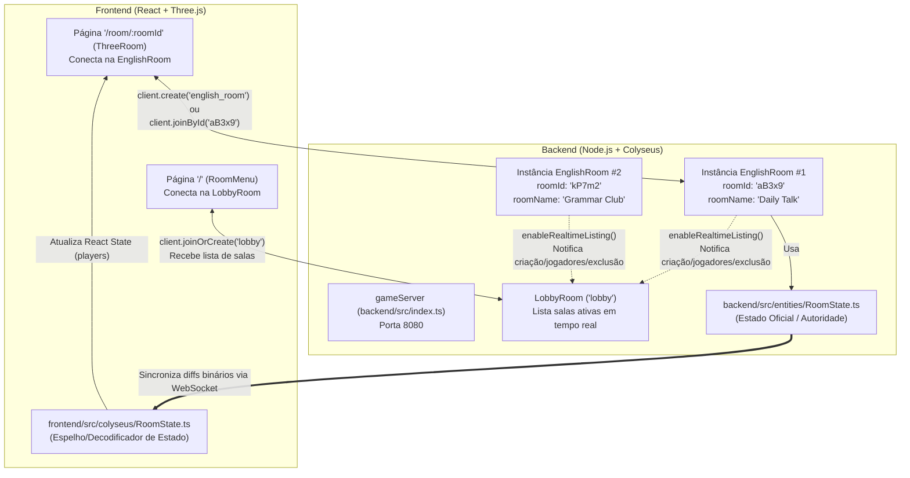

# Guia Completo: Como o Colyseus e a Arquitetura do Projeto Funcionam

Este documento explica do zero como o **Colyseus** funciona neste projeto, o que é cada classe e sala (`LobbyRoom`, `EnglishRoom`, `RoomState`, `Player`, `Client`, `Room`), e como o **Backend** e o **Frontend** conversam entre si.

---

## 1. O que é o Colyseus e qual problema ele resolve?

Em um jogo ou aplicação multiplayer em tempo real (como a nossa arena 3D), vários usuários precisam ver a posição uns dos outros a cada fração de segundo.

Se você fizesse isso apenas com **WebSockets puros** (ou `Socket.io`), você teria que programar manualmente:
1. Um sistema para criar salas, gerar IDs únicos e destruir salas vazias;
2. Um sistema para impedir que uma sala passe do limite máximo de jogadores;
3. Uma lista em tempo real das salas abertas para mostrar no menu;
4. Um protocolo para enviar `JSON.stringify({ players: ... })` 20 ou 60 vezes por segundo para todos os clientes (o que consome muita banda e deixa tudo lento).

O **Colyseus** é um framework multiplayer para Node.js + navegador que já resolve esses 4 problemas automaticamente:
- **MatchMaker (Gerenciador de Salas):** Cria, busca, bloqueia (quando lota) e destrói salas automaticamente quando ficam vazias.
- **Sincronização de Estado Binário (`@colyseus/schema`):** Você altera uma variável normal no servidor (`player.x = 5`) e o Colyseus detecta apenas os bytes que mudaram e atualiza automaticamente os clientes conectados.
- **Lobby Nativo (`LobbyRoom`):** Uma sala especial já pronta que avisa o menu toda vez que uma sala é criada, atualizada ou destruída.

---

## 2. Visão Geral: Como Tudo se Relaciona



---

## 3. O Servidor (`backend/src/index.ts`): Moldes vs. Instâncias

No arquivo [`backend/src/index.ts`](file:///home/user/rooms/backend/src/index.ts):

```ts
const httpServer = http.createServer();

const gameServer = new Server({
  transport: new WebSocketTransport({
    server: httpServer,
  }),
});

gameServer.define("lobby", LobbyRoom);
gameServer.define("english_room", EnglishRoom as any).enableRealtimeListing();

gameServer.listen(port);
```

### O que acontece aqui?
1. **`gameServer.define("nome", Classe)` não cria uma sala imediatamente!**
   Ele apenas registra uma **"planta" (molde/blueprint)** no servidor.
   - `"lobby"` usa a classe pronta `LobbyRoom` do próprio Colyseus.
   - `"english_room"` usa a nossa classe [`EnglishRoom`](file:///home/user/rooms/backend/src/colyseus/EnglishRoom.ts).
2. **Molde vs. Instância:**
   - `"english_room"` é o **tipo** da sala.
   - Quando o Jogador A clica em "Create Room", o Colyseus dá um `new EnglishRoom()` na memória do servidor e gera um `roomId` único (ex: `"xK9pL2mQ"`).
   - Se o Jogador B também clicar em "Create Room", o Colyseus dá **outro** `new EnglishRoom()` totalmente isolado, com outro `roomId` (ex: `"mN4vR8zW"`).
3. **Por que usamos `gameServer.listen(port)` e não `httpServer.listen(port)`?**
   - Antes de abrir a conexão WebSocket, o cliente Colyseus faz uma chamada HTTP `POST` para o servidor (ex: `POST http://localhost:8080/matchmake/create/english_room`) pedindo uma vaga.
   - O `gameServer.listen(port)` é quem registra essas rotas `/matchmake/...` no servidor HTTP. Depois que o MatchMaker responde com o `roomId` e `sessionId`, o navegador abre o WebSocket direto com aquela sala.

---

## 4. O que é a `LobbyRoom` e como o Menu (`RoomMenu`) funciona?

Quando o usuário abre a tela inicial (`/`), ele ainda **não está dentro de nenhuma sala 3D**, mas ele precisa ver na tela quais salas `"english_room"` existem naquele momento e quantos jogadores estão em cada uma.

É para isso que serve a **`LobbyRoom`**:

1. **No Backend (`backend/src/index.ts`):**
   Quando encadeamos `.enableRealtimeListing()` em:
   ```ts
   gameServer.define("english_room", EnglishRoom).enableRealtimeListing();
   ```
   Estamos dizendo ao Colyseus: *"Toda vez que uma `EnglishRoom` for criada, mudar de número de jogadores, mudar de metadata ou for destruída, avise automaticamente a `LobbyRoom`"*.

2. **No Frontend (`frontend/src/pages/RoomMenu/index.tsx`):**
   Assim que o menu abre, ele se conecta na sala `"lobby"`:
   ```ts
   const room = await client.joinOrCreate("lobby");
   ```
   A `LobbyRoom` envia automaticamente **3 tipos de mensagens** para o nosso menu:
   - **`room.onMessage("rooms", (rooms) => ...)`**: Enviada assim que você entra no menu. Contém o array completo de todas as salas `"english_room"` abertas naquele instante.
   - **`room.onMessage("+", ([roomId, roomData]) => ...)`**: Enviada em tempo real quando alguém cria uma sala nova **ou** quando alguém entra/sai de uma sala existente (atualizando o contador `2 / 8`).
   - **`room.onMessage("-", (roomId) => ...)`**: Enviada em tempo real quando o último jogador sai de uma sala e ela deixa de existir (removendo o card da tela imediatamente).

3. **Por que usamos `this.setMetadata({ roomName: rawName })` na `EnglishRoom`?**
   Quem está no menu (`LobbyRoom`) **não** baixa o estado 3D interno (`RoomState`) de todas as salas do servidor (isso seria pesado). A `LobbyRoom` só recebe informações públicas resumidas de cada sala: `roomId`, `clients` (jogadores atuais), `maxClients` (capacidade máxima) e `metadata`. Por isso salvamos o `roomName` no `metadata`: para que o card no menu consiga exibir o nome da sala antes de você entrar nela.

### 4.1. Por baixo dos panos: `"rooms"`, `"+"` e `"-"` são padrões do Colyseus? E como a `LobbyRoom` descobre as `EnglishRoom`s?

**Sim!** Os nomes de mensagem `"rooms"`, `"+"` e `"-"` **são 100% nativos do Colyseus** — eles estão programados diretamente dentro da classe [`LobbyRoom`](file:///home/user/rooms/backend/node_modules/@colyseus/core/build/rooms/LobbyRoom.mjs#L5-L94) da biblioteca `@colyseus/core`. Você não precisou criar nenhum código no backend para enviar `"rooms"`, `"+"` ou `"-"`.

Veja exatamente como a `LobbyRoom` consegue pegar os dados das `EnglishRoom`s em **3 passos internos do Colyseus**:

#### Passo 1: O `.enableRealtimeListing()` instala "espiões" (eventos) na `EnglishRoom`
No arquivo [`backend/src/index.ts`](file:///home/user/rooms/backend/src/index.ts#L20), quando você escreve:
```ts
gameServer.define("english_room", EnglishRoom).enableRealtimeListing();
```
O método [`enableRealtimeListing()`](file:///home/user/rooms/backend/node_modules/@colyseus/core/build/matchmaker/RegisteredHandler.mjs#L28-L43) do próprio Colyseus executa exatamente isto por baixo dos panos:
```ts
// Código real dentro de @colyseus/core (RegisteredHandler.mjs):
enableRealtimeListing() {
  this.realtimeListingEnabled = true;
  this.on("create", (room) => updateLobby(room));
  this.on("lock", (room) => updateLobby(room));
  this.on("unlock", (room) => updateLobby(room));
  this.on("join", (room) => updateLobby(room));
  this.on("leave", (room, _, willDispose) => {
    if (!willDispose) {
      updateLobby(room);
    }
  });
  this.on("metadata-change", (room) => updateLobby(room));
  this.on("dispose", (room) => updateLobby(room, true));
  return this;
}
```
Ou seja: sempre que **qualquer** instância de `EnglishRoom` é criada (`create`), alguém entra (`join`), alguém sai (`leave`), chama `setMetadata` (`metadata-change`) ou é destruída (`dispose`), o Colyseus dispara automaticamente a função interna `updateLobby(room)`.

#### Passo 2: O `updateLobby` publica um aviso no canal interno `"$lobby"`
Toda sala no Colyseus mantém uma ficha resumida interna chamada `room._listing` no **MatchMaker** (contendo `{ roomId, name: "english_room", clients, maxClients, locked, metadata }`).
- Quando `this.setMetadata({ roomName: rawName })` ou `this.maxClients = maxClients` roda dentro da sua [`EnglishRoom`](file:///home/user/rooms/backend/src/colyseus/EnglishRoom.ts#L53-L60), o Colyseus grava esses valores nessa ficha `room._listing`.
- Em seguida, a função [`updateLobby`](file:///home/user/rooms/backend/node_modules/@colyseus/core/build/matchmaker/Lobby.mjs#L4-L14) publica uma notificação no canal interno `"$lobby"` do servidor dizendo: *"A sala `roomId` acabou de ser atualizada (ou removida)"*.

#### Passo 3: A `LobbyRoom` escuta o canal `"$lobby"` e envia `"rooms"`, `"+"` e `"-"`
Dentro do código nativo da [`LobbyRoom`](file:///home/user/rooms/backend/node_modules/@colyseus/core/build/rooms/LobbyRoom.mjs#L21-L63):
1. Quando um usuário abre o menu e entra na `LobbyRoom` (`onJoin`), ela executa:
   ```ts
   // Código real dentro da LobbyRoom do Colyseus:
   client.send("rooms", this.rooms);
   ```
   Enviando a lista inicial com todas as fichas públicas (`this.rooms`) que o MatchMaker tem abertas.
2. Quando o canal `"$lobby"` avisa que uma `EnglishRoom` foi criada ou teve alteração de jogadores/metadata, a `LobbyRoom` executa:
   ```ts
   client.send("+", [roomId, data]);
   ```
3. Quando o canal `"$lobby"` avisa que uma `EnglishRoom` sofreu `dispose` (ficou com 0 jogadores), a `LobbyRoom` executa:
   ```ts
   client.send("-", roomId);
   ```

---

### 4.2. O Colyseus lê as propriedades `private` da `EnglishRoom`? E como `activeRoomNames` enxerga todas as salas?

Aqui existem dois conceitos fundamentais de TypeScript/JavaScript que acontecem em [`backend/src/colyseus/EnglishRoom.ts`](file:///home/user/rooms/backend/src/colyseus/EnglishRoom.ts#L26-L32):

```ts
export class EnglishRoom extends Room<{ state: RoomState }> {
  private static activeRoomNames = new Set<string>();
  private normalizedRoomName: string = "";

  private voiceReadyClients = new Set<string>();
  private verticalVelocities = new Map<string, number>();
```

#### 1. O Colyseus NÃO lê suas propriedades `private`
O Colyseus e a `LobbyRoom` **não sabem que existem** `activeRoomNames`, `normalizedRoomName`, `voiceReadyClients` ou `verticalVelocities`. Essas propriedades `private` são 100% suas (para a lógica interna da sua sala).
A `LobbyRoom` só enxerga o que você passa para os métodos/propriedades **herdados da classe pai `Room` do Colyseus**:
- `this.maxClients = maxClients` (propriedade da classe `Room`);
- `this.setMetadata({ roomName: rawName })` (método da classe `Room` que copia `{ roomName }` para a ficha pública da sala).

#### 2. O segredo do `static` em `private static activeRoomNames`
Por que uma sala consegue saber os nomes das outras salas se cada sala é um `new EnglishRoom()` separado?
Por causa da palavra-chave **`static`**!

Em programação orientada a objetos (TypeScript/JavaScript):
- **Propriedade normal (sem `static`), ex: `private normalizedRoomName = ""`**
  Pertence à **instância (`this`)**. Se existem 3 salas abertas, existem 3 variáveis `this.normalizedRoomName` separadas na memória (uma dentro de cada sala).
- **Propriedade estática (com `static`), ex: `private static activeRoomNames = new Set<string>()`**
  Pertence à **Classe `EnglishRoom` em si**, e **não** às instâncias! Existe **apenas UM único `Set` `EnglishRoom.activeRoomNames` em todo o servidor Node.js**, compartilhado por todas as salas criadas.

Por isso, dentro do código você acessa usando o nome da classe (`EnglishRoom.activeRoomNames`) e não `this`:
1. **Sala 1 é criada com nome `"Daily"`:**
   - Ela olha na lista única global `EnglishRoom.activeRoomNames.has("daily")` -> `false`.
   - Ela anota `"daily"` na lista global: `EnglishRoom.activeRoomNames.add("daily")`.
   - E guarda `"daily"` na memória individual dela: `this.normalizedRoomName = "daily"`.
2. **Sala 2 tenta ser criada com o mesmo nome `"Daily"`:**
   - Ela olha na **mesma** lista única global `EnglishRoom.activeRoomNames.has("daily")` -> `true`!
   - Ela bloqueia a criação com `throw new ServerError(400, "Room name is already in use.")`.
3. **Sala 1 fica vazia (`onDispose`):**
   - Ela lê o próprio `this.normalizedRoomName` (`"daily"`) e apaga da lista global: `EnglishRoom.activeRoomNames.delete(this.normalizedRoomName)`.

---

### 4.3. Por que o `"rooms"` só envia as `EnglishRoom`s? E se eu criar outro tipo de sala?

1. **Por que a própria `"lobby"` não aparece na lista de salas?**
   Porque dentro do código nativo da `LobbyRoom` (no `onCreate`), a primeira linha que o Colyseus executa é:
   ```ts
   this["_listing"].unlisted = true;
   ```
   Ou seja, a `LobbyRoom` marca a si mesma como `unlisted` (não listada), então ela nunca aparece na busca de salas. Como o único outro tipo de sala registrado no seu [`backend/src/index.ts`](file:///home/user/rooms/backend/src/index.ts#L19-L20) é `"english_room"`, apenas as instâncias de `"english_room"` aparecem.

2. **E se no futuro você criar outro tipo de sala (ex: `"spanish_room"` ou `"game_room"`)?**
   - Se você **não** colocar `.enableRealtimeListing()` na outra sala, ela não enviará eventos em tempo real para o Lobby.
   - Se você tiver vários tipos de salas com `.enableRealtimeListing()` (por exemplo, `"english_room"` e `"spanish_room"`), por padrão a `LobbyRoom` envia **todas** as salas públicas listadas.
   - **Como filtrar apenas um tipo de sala na `LobbyRoom`?**
     A `LobbyRoom` já tem um filtro nativo pronto! Basta passar `filter: { name: "english_room" }` ao conectar no Lobby:
     ```ts
     const room = await client.joinOrCreate("lobby", {
       filter: { name: "english_room" },
     });
     ```
     Ou enviar uma mensagem `"filter"` a qualquer momento:
     ```ts
     lobbyRoom.send("filter", { name: "english_room" });
     ```
     Assim a `LobbyRoom` filtra no servidor (`filter.name === room.name`) e só envia para aquele cliente as salas do tipo `"english_room"`.

---

### 4.4. Se eu não configuro endpoints HTTP/WebSocket manualmente, como um evento (como `join` ou `move`) sabe qual `EnglishRoom` específica deve escutá-lo?

Essa é a mágica do protocolo do Colyseus. Existem **2 níveis** de comunicação e nenhum deles exige que você crie rotas Express manualmente:

#### Nível 1: Eventos de Ciclo de Vida (`onCreate`, `onJoin`, `onLeave`) — Roteados pelo MatchMaker
Quando você chama um método do `client` no frontend, o SDK do Colyseus conversa com endpoints internos que o próprio `gameServer.listen(port)` criou automaticamente:

1. **Ao criar (`client.create("english_room", options)`):**
   - O SDK faz por baixo dos panos: `POST http://localhost:8080/matchmake/create/english_room` enviando `options` no body.
   - O servidor Colyseus vê o nome `"english_room"` na URL, procura no `gameServer.define("english_room", EnglishRoom)`, instancia `new EnglishRoom()` e **chama `onCreate(options)`**.
   - O servidor responde para o navegador um JSON com o endereço exato daquela instância:
     ```json
     { "roomId": "xK9pL2mQ", "sessionId": "sess_123", "processId": "proc_1" }
     ```
   - Imediatamente, o SDK no navegador abre um **WebSocket exclusivo para aquela sala**:
     ```text
     ws://localhost:8080/proc_1/xK9pL2mQ?sessionId=sess_123
     ```
   - Assim que esse WebSocket conecta na sala `"xK9pL2mQ"`, o servidor **dispara automaticamente o `onJoin(client, options)`** dentro daquela instância específica de `EnglishRoom`!

2. **Ao entrar por ID (`client.joinById("xK9pL2mQ")`):**
   - O SDK faz `POST http://localhost:8080/matchmake/joinById/xK9pL2mQ`.
   - O servidor reserva a vaga na sala `"xK9pL2mQ"`, o navegador abre o WebSocket `ws://localhost:8080/proc_1/xK9pL2mQ?sessionId=sess_456`, e o servidor **dispara automaticamente o `onJoin(client)`** na sala `"xK9pL2mQ"`.

3. **Ao sair (`room.leave()` ou fechar a aba):**
   - O WebSocket `ws://.../xK9pL2mQ` é fechado, e o servidor **dispara automaticamente o `onLeave(client)`** (e o `onDispose()` se não sobrar ninguém).

#### Nível 2: Eventos Customizados (`room.send` ↔ `this.onMessage`) — Roteados pelo WebSocket exclusivo da Sala
Repare que no frontend você não faz `client.send("move")` — você faz **`room.send("move", { x, z })`** no objeto `room` retornado pelo `client.create` ou `client.joinById`!

- Como cada objeto `room` no frontend tem o seu **próprio túnel WebSocket conectado diretamente ao `roomId` daquela sala** (`ws://localhost:8080/proc_1/xK9pL2mQ`):
  - Quando você chama `room.send("move", { x, z })` ou `room.send("jump")`, essa mensagem trafega pelo WebSocket da sala `"xK9pL2mQ"` e cai **diretamente e exclusivamente** no `this.onMessage("move", ...)` da instância `EnglishRoom` de ID `"xK9pL2mQ"`.
  - E no [` EnglishRoom.ts`](file:///home/user/rooms/backend/src/colyseus/EnglishRoom.ts#L62), o primeiro parâmetro de `this.onMessage("move", (client, message) => ...)` já te entrega o `client` (`client.sessionId`) de quem enviou, porque o WebSocket já estava autenticado com `?sessionId=sess_123`!

---

## 5. O que é a `EnglishRoom` (`backend/src/colyseus/EnglishRoom.ts`)?

A classe [`EnglishRoom`](file:///home/user/rooms/backend/src/colyseus/EnglishRoom.ts) é o **cérebro de uma sala 3D no servidor**. Cada sala criada no menu é uma instância independente dessa classe.

O Colyseus controla o ciclo de vida da `EnglishRoom` através de **4 métodos principais (hooks)**:

### 1º — `onCreate(options)` (Nasce a sala)
Executado **uma única vez** quando um jogador chama `client.create("english_room", { roomName, maxClients })`.
- Recebe as opções enviadas pelo modal do frontend (`roomName` e `maxClients`).
- Valida se o nome foi preenchido e se já não existe no `Set` estático `EnglishRoom.activeRoomNames`. Se já existir, lança um `ServerError(400, ...)` e a sala nem chega a ser criada.
- Define `this.maxClients = maxClients` (o próprio Colyseus bloqueia a entrada de novos jogadores quando atingir esse número).
- Inicializa o estado oficial da sala: `this.state = new RoomState()`.
- Registra os **ouvintes de comandos dos jogadores (`this.onMessage`)**:
  - `"move"`: Recebe `{ x, z }` quando o jogador aperta WASD/Setas, calcula colisão (`canOccupy`) e limites do chão (`clampToFloor`), e atualiza `player.x` e `player.z`.
  - `"jump"`: Dá impulso vertical (`jumpVelocity`) se o jogador estiver no chão.
  - `"voice_ready"`, `"voice_disabled"`, `"voice_signal"`: Retransmite os sinais de WebRTC entre os jogadores para o chat de voz funcionar.
- Inicia o **loop de simulação (`this.setSimulationInterval`)** rodando a 60 FPS (`1000 / 60` ms) para aplicar gravidade nos jogadores que pularam.

### 2º — `onJoin(client, options)` (Entra um jogador)
Executado **toda vez que um jogador entra na sala** (tanto o criador quanto quem entrou depois pelo ID ou pela lista).
- Cada conexão tem um identificador único gerado pelo Colyseus: `client.sessionId`.
- Cria um `new Player()`, escolhe uma posição livre na arena (`findSpawnPosition()`), sorteia uma cor hexadecimal e guarda no mapa de jogadores da sala:
  ```ts
  this.state.players.set(client.sessionId, player);
  ```

### 3º — `onLeave(client, code)` (Sai um jogador)
Executado quando um jogador clica em **"Leave Room"** ou fecha a aba do navegador.
- Remove o jogador do estado da sala:
  ```ts
  this.state.players.delete(client.sessionId);
  ```
- Avisa os demais jogadores para encerrarem a conexão de voz com quem saiu (`broadcast("voice-peer-left", ...)`).

### 4º — `onDispose()` (Morre a sala quando fica com 0 jogadores)
Por padrão no Colyseus, toda sala tem `autoDispose = true`. Isso significa que **assim que o último jogador sai (`clients === 0`), o Colyseus chama `onDispose()` automaticamente e apaga a sala da memória**.
- No `onDispose()`, removemos o nome da sala de `EnglishRoom.activeRoomNames`, liberando esse nome para ser usado novamente no futuro.

---

## 6. O que são essas classes `RoomState` e `Player` no Frontend e no Backend?

Você deve ter reparado que existem dois arquivos muito parecidos:
1. **No Backend:** [`backend/src/entities/RoomState.ts`](file:///home/user/rooms/backend/src/entities/RoomState.ts)
2. **No Frontend:** [`frontend/src/colyseus/RoomState.ts`](file:///home/user/rooms/frontend/src/colyseus/RoomState.ts)

### Por que essas classes existem nos dois lados?
O Colyseus **não envia JSON** para sincronizar a posição dos jogadores (porque enviar texto `"x": 1.2345, "y": 0.5, "z": -3.45` 60 vezes por segundo deixaria a rede lenta). Em vez disso, ele usa o pacote `@colyseus/schema`, que **compacta o estado em bytes binários** super leves.

Para que o **Backend** saiba compactar os dados em bytes e o **Frontend** saiba descompactar esses bytes de volta em objetos JavaScript, **os dois lados precisam conhecer o formato exato (Schema) dos dados**:

| Classe | O que ela representa | Propriedades sincronizadas |
| :--- | :--- | :--- |
| **`Player`** | Um cubo/jogador dentro da arena 3D | `x` (`number`), `y` (`number`), `z` (`number`), `color` (`string`) |
| **`RoomState`** | O estado completo de uma sala `EnglishRoom` | `players` (`MapSchema<Player>` onde a chave é o `sessionId`), `roomName` (`string`), `maxClients` (`number`) |

### Por que a sintaxe é um pouco diferente entre Backend e Frontend?
- No **Backend** ([`backend/src/entities/RoomState.ts`](file:///home/user/rooms/backend/src/entities/RoomState.ts)), usamos decorators (`@type("number") x = 0;`).
- No **Frontend** ([`frontend/src/colyseus/RoomState.ts`](file:///home/user/rooms/frontend/src/colyseus/RoomState.ts)), usamos a função auxiliar `defineTypes(Player, { x: "number", ... })`. Ambos fazem **exatamente a mesma coisa** por baixo dos panos, mas `defineTypes` evita problemas de configuração de decorators experimentais no compilador do Vite/React.

---

## 7. Como funciona a Sala 3D no Frontend (`frontend/src/pages/Room/index.tsx`)?

Quando você sai do menu (`RoomMenu`) e vai para a tela da sala 3D ([`ThreeRoom`](file:///home/user/rooms/frontend/src/pages/Room/index.tsx)), o React precisa resolver **3 problemas**:
1. **Conectar na sala certa** (criar uma nova ou entrar em uma que já existe).
2. **Traduzir a memória do Colyseus para o `useState` do React** (para desenhar os cubos 3D na tela).
3. **Mandar seus comandos de teclado (`WASD` / `Espaço`) para o servidor**.

Vamos ver como cada uma dessas partes funciona passo a passo:

---

### Passo 1: Como a página sabe se deve CRIAR uma sala ou ENTRAR em uma existente?
Na rota do React Router (`App.tsx`), temos `/room/:roomId`. Quando o componente [`ThreeRoom`](file:///home/user/rooms/frontend/src/pages/Room/index.tsx#L19-L115) abre, ele olha para o `:roomId` da URL:

- **Caso A — Você clicou em "Create Room" no Modal (`/room/new`):**
  Quando você preenche o modal no menu e confirma, ainda não existe um ID de sala (porque quem gera o ID é o servidor). Então o menu te envia para `/room/new` passando `{ roomName, maxClients }` no `location.state` do React Router:
  ```ts
  room = await client.create(
    'english_room',
    { roomName: createState.roomName, maxClients: createState.maxClients ?? 8 },
    RoomState, // <-- Diz ao Colyseus qual classe usar para descompactar o estado binário
  );
  ```
  Assim que o servidor cria a sala e devolve `room.roomId` (ex.: `"xK9pL2mQ"`), nós trocamos a URL de `/room/new` para `/room/xK9pL2mQ`:
  ```ts
  redirect(`/room/${room.roomId}`, { replace: true });
  ```
  *(Por que fazemos isso? Para que, se você der F5 na página ou copiar o link da barra de endereços e mandar para um amigo, o link já tenha o ID real da sala!)*

- **Caso B — Você clicou em uma sala da lista ou digitou o ID (`/room/xK9pL2mQ`):**
  Como o `:roomId` na URL não é `"new"`, o código cai no `else` e entra diretamente na sala existente:
  ```ts
  room = await client.joinById(initialRoomId, {}, RoomState);
  ```

- **E se der erro? (Sala cheia, ID que não existe, ou nome duplicado):**
  A promessa (`await client.create` ou `await client.joinById`) falha e cai no `catch (err)`. Lá nós redirecionamos o usuário de volta para o menu (`'/'`) enviando o texto do erro para aparecer no banner vermelho (`<ErrorBanner />`).

---

### Passo 2: Por que precisamos de `getStateCallbacks` e `onStateChange`? (A Ponte Colyseus → React)

Aqui está o ponto que mais confunde quem vem do React tradicional:
- O Colyseus mantém o estado da sala dentro de `room.state` (que é uma instância de `RoomState`).
- Quando um jogador se mexe no servidor, o Colyseus recebe os bytes pelo WebSocket e **altera as propriedades de `room.state.players` diretamente por baixo dos panos** (mutação direta: `player.x = 2.5`).
- Porém, **o React não sabe quando um objeto externo sofre mutação direta!** O React só re-renderiza a tela quando você chama um `setState` (no nosso caso, `setPlayers(...)`, `setActiveRoomName(...)`, `setMaxClientsCount(...)`).

Por isso, em [`Room/index.tsx`](file:///home/user/rooms/frontend/src/pages/Room/index.tsx#L122-L152), nós criamos uma **"ponte"** que escuta os eventos de mutação do Colyseus e avisa o React:

```ts
const stateCallbacks = getStateCallbacks(room);
```

Veja o que cada ouvinte dessa ponte faz:

1. **`room.onStateChange((state) => ...)` — Sincroniza os dados do HUD:**
   Toda vez que o estado geral da sala muda no servidor, copiamos `state.roomName` e `state.maxClients` para os states do React (`activeRoomName` e `maxClientsCount`), que são exibidos no painel `<RoomHud />`.

2. **`stateCallbacks(room.state).players.onAdd((player, playerSessionId) => ...)` — Nasce um Cubo 3D:**
   Dispara:
   - Imediatamente para **cada jogador que já estava na sala** quando você entrou;
   - E toda vez que um **novo jogador entra** na sala (`this.state.players.set(sessionId, player)` lá no backend).
   
   Quando isso acontece, colocamos esse jogador no state `players` do React:
   ```ts
   setPlayers((prev) => ({ ...prev, [playerSessionId]: player }));
   ```
   Isso faz o componente [`RoomScene`](file:///home/user/rooms/frontend/src/pages/Room/components/RoomScene/index.tsx) renderizar um novo `<PlayerBody />` na arena 3D!

3. **`stateCallbacks(player).onChange(() => ...)` — O Cubo 3D se move:**
   Dentro do `onAdd` de cada jogador, penduramos um ouvinte naquele jogador específico: *"Sempre que o servidor mudar o `x`, `y`, `z` ou `color` deste jogador, avise o React"*:
   ```ts
   stateCallbacks(player).onChange(() => {
     setPlayers((prev) => ({ ...prev, [playerSessionId]: player }));
   });
   ```
   Quando `setPlayers` roda, o `<PlayerBody />` recebe as novas coordenadas `player.x, player.y, player.z` e desliza o cubo 3D suavemente (`lerp`) até a nova posição.

4. **`stateCallbacks(room.state).players.onRemove((_player, playerSessionId) => ...)` — Desaparece o Cubo 3D:**
   Dispara quando alguém sai da sala (`this.state.players.delete(sessionId)` lá no backend). Nós deletamos o `playerSessionId` do state `players` do React e o cubo daquele jogador some da cena 3D imediatamente.

---

### Passo 3: Como o seu teclado move o seu cubo? (O Loop de Movimento Autoritativo)

Talvez você se pergunte: *"Quando eu aperto `W`, o frontend muda `meuPlayer.z -= 1` direto na tela?"*
**Não!** Se o frontend mudasse a própria posição sozinho, qualquer pessoa poderia abrir o console do navegador e se teletransportar, ou cada jogador veria os outros em posições diferentes.

Em vez disso, funciona em um **ciclo de ida e volta (Servidor Autoritativo)**:

```mermaid
sequenceDiagram
    participant Teclado as 1. Seu Teclado (useHotkeys)
    participant Loop as 2. setInterval (a cada 50ms)
    participant Server as 3. Backend (EnglishRoom)
    participant React as 4. Ponte (onChange -> PlayerBody)

    Teclado->>Loop: Segura tecla "W" (movementRef.current.forward = true)
    Loop->>Server: room.send("move", { x: 0, z: -1 })
    Note over Server: Calcula velocidade, limites da arena<br/>e colisão com outros jogadores.<br/>Atualiza player.z no RoomState!
    Server-->>React: Colyseus envia patch binário com o novo player.z
    Note over React: stateCallbacks(player).onChange dispara!<br/>PlayerBody desliza o cubo 3D na tela.
```

1. **Captura de teclas (`useHotkeys`):** Quando você segura `W`, `A`, `S`, `D` ou as setas, o hook [`useHotkeys`](file:///home/user/rooms/frontend/src/pages/Room/hooks/useHotkeys.ts) apenas marca `true` ou `false` dentro de `movementRef.current` (`{ forward: true, backward: false, ... }`). Quando você aperta `Espaço`, ele chama `roomRef.current?.send('jump')`.
2. **Envio contínuo a cada 50ms ([`Room/index.tsx`](file:///home/user/rooms/frontend/src/pages/Room/index.tsx#L177-L196)):**
   Um `setInterval` roda 20 vezes por segundo (a cada `50ms`). Se alguma tecla de direção estiver pressionada (`x !== 0 || z !== 0`), ele envia para o servidor:
   ```ts
   room.send('move', { x, z });
   ```
3. **Validação no Backend ([`EnglishRoom.ts`](file:///home/user/rooms/backend/src/colyseus/EnglishRoom.ts#L67-L82)):**
   O servidor recebe `{ x, z }`, verifica se o seu cubo não vai atravessar o limite do chão (`clampToFloor`) nem bater em outro jogador (`canOccupy`), e atualiza `player.x` e `player.z`.
4. **Atualização na tela de todo mundo:**
   Assim que o servidor muda `player.x` e `player.z`, o Colyseus transmite a nova coordenada para você e para todos os outros jogadores da sala. O `onChange` (do Passo 2) dispara no navegador de todo mundo e move o cubo!

---

### Passo 4: O que acontece ao clicar em "Leave Room" ou voltar a página?
No final do `useEffect` de conexão ([`Room/index.tsx`](file:///home/user/rooms/frontend/src/pages/Room/index.tsx#L166-L174)), retornamos a função de limpeza (`cleanup`) do React:
```ts
return () => {
  detached = true;
  if (room) {
    room.leave();
  }
};
```
Assim que o componente `ThreeRoom` é desmontado (seja clicando no botão **Leave Room**, voltando no navegador ou indo para `'/'`), `room.leave()` encerra o WebSocket da sala imediatamente, fazendo o servidor remover seu cubo da arena para os outros jogadores.
