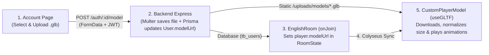

# Tutorial: Custom 3D Models (`.glb`) with Walk/Jump Animations & Account Upload

This guide explains:
1. How to replace the default 3D cube in [`PlayerBody/index.tsx`](file:///home/pedrovidal/rooms/frontend/src/pages/Room/components/PlayerBody/index.tsx) with an animated 3D model (`Idle`, `Walk`, `Jump`) that rotates toward the movement direction.
2. How to allow users to **upload their own `.glb` 3D model** on the [`Account`](file:///home/pedrovidal/rooms/frontend/src/pages/Account/index.tsx) page, store it on the backend, synchronize it via **Colyseus**, and automatically normalize its scale, foot alignment, and animations for every player in the room.

---

## Architecture Overview



---

## Step 1: Add `modelUrl` to Prisma (`tb_users`)

1. Open [`backend/prisma/schema.prisma`](file:///home/pedrovidal/rooms/backend/prisma/schema.prisma#L17-L29) and add an optional `modelUrl` field to the `User` model:

```prisma
model User {
  id         Int       @id @default(autoincrement())
  name       String
  email      String    @unique
  password   String
  modelUrl   String?   // <-- URL path to the user's uploaded .glb file
  createdAt  DateTime  @default(now())
  updatedAt  DateTime  @updatedAt
  deletedAt  DateTime?
  isActive   Boolean   @default(true)
  isVerified Boolean   @default(false)

  @@map("tb_users")
}
```

2. Run the Prisma migration inside `backend/`:
```bash
cd backend
npx prisma migrate dev --name add_user_model_url
```

3. Update [`backend/src/user/entities/user.entity.ts`](file:///home/pedrovidal/rooms/backend/src/user/entities/user.entity.ts) and [`backend/src/user/dtos/user.dto.ts`](file:///home/pedrovidal/rooms/backend/src/user/dtos/user.dto.ts) so `User`, `User.fromModel()`, and `user.toDto()` include `modelUrl: string | null`.

---

## Step 2: Create the `.glb` Upload Endpoint on the Backend

1. Install `multer` (for `multipart/form-data` uploads) and `cors` (so Three.js `useGLTF` can fetch `.glb` files across ports):
```bash
cd backend
npm install multer cors
npm install -D @types/multer @types/cors
```

2. Serve the uploaded files statically in [`backend/src/index.ts`](file:///home/pedrovidal/rooms/backend/src/index.ts#L17-L21):
```ts
import cors from "cors";
import path from "path";

const app = express();
app.use(cors()); // Required so Three.js useGLTF can fetch .glb files from the backend
app.use(bodyParser.json());

// Serve uploaded 3D models at http://localhost:8080/uploads/models/...
app.use("/uploads", express.static(path.resolve(process.cwd(), "uploads")));

app.use("/auth", userRoutes);
app.use("/auth", authRoutes);
```

3. Configure `multer` and add the `POST /:id/model` route in [`backend/src/user/routers/user.router.ts`](file:///home/pedrovidal/rooms/backend/src/user/routers/user.router.ts):
```ts
import { Router } from "express";
import multer from "multer";
import path from "path";
import fs from "fs";
import { authenticateToken } from "../../middlewares/authMiddleware.js";
import { validateData } from "../../middlewares/validationMiddleware.js";
import { UserCreateDto } from "../dtos/userCreate.dto.js";
import { UserUpdateDto } from "../dtos/userUpdate.dto.js";
import { container } from "tsyringe";
import { UserController } from "../controllers/user.controller.js";

const router = Router();
const userController = container.resolve(UserController);

const uploadDir = path.resolve(process.cwd(), "uploads/models");
fs.mkdirSync(uploadDir, { recursive: true });

const uploadModel = multer({
  storage: multer.diskStorage({
    destination: (_req, _file, cb) => cb(null, uploadDir),
    filename: (req, _file, cb) => {
      cb(null, `user-${req.params.id}-${Date.now()}.glb`);
    },
  }),
  limits: { fileSize: 15 * 1024 * 1024 }, // 15 MB max
  fileFilter: (_req, file, cb) => {
    if (file.originalname.toLowerCase().endsWith(".glb")) {
      cb(null, true);
    } else {
      cb(new Error("Only .glb 3D model files are allowed"));
    }
  },
});

router.post("/register", validateData(UserCreateDto), (req, res) =>
  userController.register(req, res),
);
router.put("/:id", authenticateToken, validateData(UserUpdateDto), (req, res) =>
  userController.update(req, res),
);
router.post(
  "/:id/model",
  authenticateToken,
  uploadModel.single("model"),
  (req, res) => userController.uploadModel(req, res),
);

export default router;
```

4. Add `uploadModel` in [`backend/src/user/controllers/user.controller.ts`](file:///home/pedrovidal/rooms/backend/src/user/controllers/user.controller.ts) and `updateModelUrl` in [`backend/src/user/services/user.service.ts`](file:///home/pedrovidal/rooms/backend/src/user/services/user.service.ts):

```ts
// Inside UserController (backend/src/user/controllers/user.controller.ts):
public async uploadModel(req: Request, res: Response): Promise<void> {
  try {
    const authenticatedUserId = Number(req.user?.sub);
    const targetUserId = Number(req.params.id);

    if (!req.file) {
      res.status(400).json({ message: "No .glb file uploaded" });
      return;
    }

    const modelUrl = `/uploads/models/${req.file.filename}`;
    const result = await this.userService.updateModelUrl(
      authenticatedUserId,
      targetUserId,
      modelUrl,
    );

    res.status(200).json(result);
  } catch (error) {
    const message = error instanceof Error ? error.message : "Error uploading model";
    const status = message.startsWith("Forbidden") ? 403 : 400;
    res.status(status).json({ message });
  }
}
```

```ts
// Inside UserService (backend/src/user/services/user.service.ts):
public async updateModelUrl(
  authenticatedUserId: number,
  targetUserId: number,
  modelUrl: string,
): Promise<{ modelUrl: string }> {
  if (!authenticatedUserId || authenticatedUserId !== targetUserId) {
    throw new Error("Forbidden: you can only update your own account");
  }

  await this.userRepository.update(targetUserId, { modelUrl });
  return { modelUrl };
}
```

---

## Step 3: Add the Upload UI to the Account Page

1. Add the upload request helper to [`frontend/src/pages/Account/helpers.ts`](file:///home/pedrovidal/rooms/frontend/src/pages/Account/helpers.ts):
```ts
export const BACKEND_BASE_URL = (
  import.meta.env.VITE_WEBSOCKET_SERVER ?? "ws://localhost:8080"
).replace(/^ws/, "http");

export const uploadUser3DModel = async (
  userId: number,
  file: File,
): Promise<{ modelUrl: string }> => {
  const token = getAuthToken();
  const formData = new FormData();
  formData.append("model", file);

  const response = await fetch(`${BACKEND_BASE_URL}/auth/${userId}/model`, {
    method: "POST",
    headers: {
      Authorization: `Bearer ${token}`,
    },
    body: formData,
  });

  if (!response.ok) {
    const err = await response.json().catch(() => ({}));
    throw new Error(err.message || "Falha ao enviar o modelo 3D.");
  }

  return response.json();
};
```

2. Add the **3D Model Upload** section inside [`frontend/src/pages/Account/index.tsx`](file:///home/pedrovidal/rooms/frontend/src/pages/Account/index.tsx):
```tsx
// Add state inside Account component:
const [selectedModelFile, setSelectedModelFile] = useState<File | null>(null);
const [isUploadingModel, setIsUploadingModel] = useState(false);
const [modelSuccess, setModelSuccess] = useState<string | null>(null);

const handleModelUpload = async () => {
  const userId = getAuthenticatedUserId();
  if (!userId || !selectedModelFile) return;

  setIsUploadingModel(true);
  setError(null);
  setModelSuccess(null);

  try {
    await uploadUser3DModel(userId, selectedModelFile);
    setModelSuccess("Modelo 3D atualizado com sucesso!");
    setSelectedModelFile(null);
  } catch (err) {
    setError(err instanceof Error ? err.message : "Erro ao enviar modelo 3D.");
  } finally {
    setIsUploadingModel(false);
  }
};
```

And place this card inside the [`Account`](file:///home/pedrovidal/rooms/frontend/src/pages/Account/index.tsx) page layout:
```tsx
<div
  style={{
    padding: "22px",
    borderRadius: 14,
    background: "#151f2a",
    border: "1px solid rgba(88, 112, 138, 0.34)",
    display: "flex",
    flexDirection: "column",
    gap: 16,
  }}
>
  <div style={{ display: "flex", flexDirection: "column", gap: 4 }}>
    <h2 style={{ margin: 0, fontSize: 16, fontWeight: 700, color: "#e7edf5" }}>
      Avatar 3D Personalizado (.glb)
    </h2>
    <span style={{ fontSize: 12, color: "rgba(231, 237, 245, 0.6)" }}>
      Envie um arquivo .glb (máx. 15MB) com animações de Idle, Walk e Jump para usar nas salas.
    </span>
  </div>

  <input
    type="file"
    accept=".glb"
    onChange={(e) => {
      const file = e.target.files?.[0] ?? null;
      setSelectedModelFile(file);
    }}
    style={{ color: "#e7edf5", fontSize: 13 }}
  />

  {modelSuccess && (
    <span style={{ fontSize: 13, color: "#67d1bf" }}>{modelSuccess}</span>
  )}

  <div style={{ display: "flex", justifyContent: "flex-end" }}>
    <Button
      type="button"
      variant="primary"
      disabled={!selectedModelFile || isUploadingModel}
      onClick={handleModelUpload}
      style={{ fontSize: 13 }}
    >
      {isUploadingModel ? "Enviando Modelo..." : "Salvar Modelo 3D"}
    </Button>
  </div>
</div>
```

---

## Step 4: Synchronize `modelUrl` Across Multiplayer (Colyseus)

1. **Backend Schema ([`backend/src/colyseus/RoomState.ts`](file:///home/pedrovidal/rooms/backend/src/colyseus/RoomState.ts#L3-L9)):**
```ts
export class Player extends Schema {
  @type("number") x: number = 0;
  @type("number") y: number = 0.5;
  @type("number") z: number = 0;
  @type("string") color: string = "#ffffff";
  @type("string") name: string = "";
  @type("string") modelUrl: string = "";
}
```

2. **Frontend Schema ([`frontend/src/colyseus/RoomState.ts`](file:///home/pedrovidal/rooms/frontend/src/colyseus/RoomState.ts#L3-L17)):**
```ts
export class Player extends Schema {
  x = 0;
  y = 0.5;
  z = 0;
  color = "#ffffff";
  name = "";
  modelUrl = "";
}

defineTypes(Player, {
  x: "number",
  y: "number",
  z: "number",
  color: "string",
  name: "string",
  modelUrl: "string",
});
```

3. **Populate `player.modelUrl` on Join ([`backend/src/colyseus/EnglishRoom.ts`](file:///home/pedrovidal/rooms/backend/src/colyseus/EnglishRoom.ts#L119-L130)):**
```ts
import { container } from "tsyringe";
import { UserRepository } from "../user/repositories/user.repository.js";

// Inside EnglishRoom:
async onJoin(client: Client, options: any) {
  const player = new Player();
  const spawn = this.findSpawnPosition();

  player.x = spawn.x;
  player.y = groundedY;
  player.z = spawn.z;
  player.color = "#" + Math.floor(Math.random() * 16777215).toString(16).padStart(6, "0");
  player.name = client.auth?.name || client.auth?.email || "";

  // Load the user's latest uploaded 3D model URL from Prisma
  const userId = Number(client.auth?.sub);
  if (!Number.isNaN(userId)) {
    const userRepo = container.resolve<UserRepository>("UserRepository");
    const dbUser = await userRepo.findBy({ id: userId });
    if (dbUser?.getModelUrl()) {
      const baseUrl = process.env.PUBLIC_BACKEND_URL ?? "http://localhost:8080";
      player.modelUrl = `${baseUrl}${dbUser.getModelUrl()}`;
    }
  }

  this.state.players.set(client.sessionId, player);
}
```

---

## Step 5: Create `CustomPlayerModel.tsx` (Cloning, Auto-Scaling & Animations)

When users upload custom `.glb` models, three things must be handled automatically:
1. **`SkeletonUtils.clone(scene)`:** In Three.js, an `Object3D` can only have one parent. Cloning with `SkeletonUtils` allows multiple players in the room to use 3D rigs independently.
2. **Auto-Scaling & Foot Alignment (`Box3`):** Different `.glb` files have wildly different heights (e.g. `0.02m` vs `180m`) and pivot points. Measuring the bounding box (`new Box3().setFromObject(clone)`) normalizes every uploaded model to `1.0m` tall (`playerHalfSize * 2`) and aligns its feet to `-0.5` (`-playerHalfSize`).
3. **Fuzzy Animation Matching:** Different `.glb` files name their clips differently (`"Walk"` vs `"Running"` vs `"Armature|walk"`). Matching clip names by regex ensures animations play reliably.

Create `frontend/src/pages/Room/components/PlayerBody/CustomPlayerModel.tsx`:

```tsx
import { Suspense, useEffect, useMemo, useRef } from "react";
import { useAnimations, useGLTF } from "@react-three/drei";
import { Box3, type Group, Vector3 } from "three";
import { SkeletonUtils } from "three-stdlib";
import { playerHalfSize } from "./consts";

export type PlayerAnimationState = "Idle" | "Walk" | "Jump";

const TARGET_HEIGHT = playerHalfSize * 2; // 1.0m to match the CuboidCollider

function findMatchingClipName(
  names: string[],
  state: PlayerAnimationState,
): string | null {
  if (names.length === 0) return null;

  const patterns: Record<PlayerAnimationState, RegExp> = {
    Jump: /jump|air|leap|fall|hop/i,
    Walk: /walk|run|jog|move|locomotion/i,
    Idle: /idle|stand|wait|breathe|rest/i,
  };

  const match = names.find((name) => patterns[state].test(name));
  return match ?? names[0];
}

const LoadedGlbModel = ({
  url,
  animation,
  sessionId,
}: {
  url: string;
  animation: PlayerAnimationState;
  sessionId: string;
}) => {
  const groupRef = useRef<Group>(null);
  const { scene, animations } = useGLTF(url);

  const { clonedScene, normalizedScale, offsetY } = useMemo(() => {
    const clone = SkeletonUtils.clone(scene);

    clone.traverse((child) => {
      if ("isMesh" in child && child.isMesh) {
        child.castShadow = true;
        child.receiveShadow = true;
        child.userData = { sessionId };
      }
    });

    const box = new Box3().setFromObject(clone);
    const size = new Vector3();
    box.getSize(size);

    const safeHeight = size.y > 0.001 ? size.y : 1;
    const scale = TARGET_HEIGHT / safeHeight;
    // Align the lowest point of the model (box.min.y) with the bottom of the collider (-playerHalfSize)
    const yOffset = -playerHalfSize - box.min.y * scale;

    return {
      clonedScene: clone,
      normalizedScale: scale,
      offsetY: yOffset,
    };
  }, [scene, sessionId]);

  const { actions, names } = useAnimations(animations, groupRef);

  useEffect(() => {
    const clipName = findMatchingClipName(names, animation);
    if (!clipName || !actions[clipName]) {
      return;
    }

    const action = actions[clipName];
    action.reset().fadeIn(0.2).play();

    return () => {
      action.fadeOut(0.2);
    };
  }, [actions, animation, names]);

  return (
    <group
      ref={groupRef}
      position={[0, offsetY, 0]}
      scale={normalizedScale}
      dispose={null}
    >
      <primitive object={clonedScene} />
    </group>
  );
};

const FallbackCube = ({
  color,
  sessionId,
}: {
  color: string;
  sessionId: string;
}) => (
  <mesh castShadow receiveShadow userData={{ sessionId }}>
    <boxGeometry args={[1, 1, 1]} />
    <meshStandardMaterial color={color} />
  </mesh>
);

export const CustomPlayerModel = ({
  modelUrl,
  animation,
  color,
  sessionId,
}: {
  modelUrl?: string;
  animation: PlayerAnimationState;
  color: string;
  sessionId: string;
}) => {
  if (!modelUrl) {
    return <FallbackCube color={color} sessionId={sessionId} />;
  }

  return (
    <Suspense fallback={<FallbackCube color={color} sessionId={sessionId} />}>
      <LoadedGlbModel
        url={modelUrl}
        animation={animation}
        sessionId={sessionId}
      />
    </Suspense>
  );
};
```

---

## Step 6: Update [`PlayerBody/index.tsx`](file:///home/pedrovidal/rooms/frontend/src/pages/Room/components/PlayerBody/index.tsx) for Rotation & Animation States

Update [`frontend/src/pages/Room/components/PlayerBody/index.tsx`](file:///home/pedrovidal/rooms/frontend/src/pages/Room/components/PlayerBody/index.tsx) to:
- Compute whether the player is in `"Idle"`, `"Walk"`, or `"Jump"` state.
- Smoothly rotate the visual 3D character toward its movement direction (`Math.atan2(vx, vz)`).
- Render `<CustomPlayerModel />` inside `<RigidBody>`.

```tsx
import { useRef, useState } from "react";
import { Html } from "@react-three/drei";
import { useFrame } from "@react-three/fiber";
import {
  CuboidCollider,
  RigidBody,
  useRapier,
  type RapierRigidBody,
} from "@react-three/rapier";
import { type Group, MathUtils, Vector3 } from "three";
import {
  playerHalfSize,
  playerJumpVelocity,
  playerNameOffsetY,
} from "./consts";
import {
  CustomPlayerModel,
  type PlayerAnimationState,
} from "./CustomPlayerModel";
import { computeHorizontalVelocity, getPlayerSmoothing } from "./helpers";
import type { PlayerBodyProps } from "./types";

export const PlayerBody = (props: PlayerBodyProps) => {
  const {
    player,
    isLocal,
    jumpRequestedRef,
    movementRef,
    onLocalPositionChange,
    sessionId,
  } = props;

  const { world, rapier } = useRapier();
  const bodyRef = useRef<RapierRigidBody>(null);
  const characterVisualRef = useRef<Group>(null);
  const targetRotationYRef = useRef(0);

  const [animation, setAnimation] = useState<PlayerAnimationState>("Idle");
  const currentAnimationRef = useRef<PlayerAnimationState>("Idle");

  const nextPositionRef = useRef(new Vector3(player.x, player.y, player.z));
  const [initialPosition] = useState<[number, number, number]>(() => [
    player.x,
    player.y,
    player.z,
  ]);
  const color = player.color;
  const playerName = player.name.trim();

  const updateAnimation = (nextAnim: PlayerAnimationState) => {
    if (currentAnimationRef.current !== nextAnim) {
      currentAnimationRef.current = nextAnim;
      setAnimation(nextAnim);
    }
  };

  const rotateCharacterSmoothly = () => {
    if (!characterVisualRef.current) return;
    const currentAngle = characterVisualRef.current.rotation.y;
    const targetAngle = targetRotationYRef.current;
    // Shortest-path angle interpolation across the -PI / +PI boundary
    const delta = Math.atan2(
      Math.sin(targetAngle - currentAngle),
      Math.cos(targetAngle - currentAngle),
    );
    characterVisualRef.current.rotation.y = currentAngle + delta * 0.2;
  };

  useFrame(() => {
    const body = bodyRef.current;
    if (!body) {
      return;
    }

    const current = body.translation();

    if (isLocal) {
      const { vx, vz } = computeHorizontalVelocity(movementRef?.current);
      const currentVel = body.linvel();
      let nextVy = currentVel.y;

      const groundShape = new rapier.Cuboid(
        playerHalfSize * 0.9,
        0.04,
        playerHalfSize * 0.9,
      );
      const groundHit = world.intersectionWithShape(
        { x: current.x, y: current.y - playerHalfSize - 0.03, z: current.z },
        { x: 0, y: 0, z: 0, w: 1 },
        groundShape,
        undefined,
        undefined,
        undefined,
        body,
      );
      const isGrounded = groundHit !== null && Math.abs(currentVel.y) <= 0.5;

      if (jumpRequestedRef?.current) {
        jumpRequestedRef.current = false;
        if (isGrounded) {
          nextVy = playerJumpVelocity;
        }
      }

      body.setLinvel({ x: vx, y: nextVy, z: vz }, true);

      const isMovingHorizontally = Math.abs(vx) > 0.01 || Math.abs(vz) > 0.01;
      if (isMovingHorizontally) {
        targetRotationYRef.current = Math.atan2(vx, vz);
      }
      rotateCharacterSmoothly();

      if (!isGrounded || Math.abs(nextVy) > 0.5) {
        updateAnimation("Jump");
      } else if (isMovingHorizontally) {
        updateAnimation("Walk");
      } else {
        updateAnimation("Idle");
      }

      nextPositionRef.current.set(current.x, current.y, current.z);
      if (onLocalPositionChange) {
        onLocalPositionChange(nextPositionRef.current);
      }
      return;
    }

    // Remote player interpolation, rotation, and animation inference
    const smoothing = getPlayerSmoothing(false);
    const dx = player.x - current.x;
    const dz = player.z - current.z;
    const horizontalDist = Math.hypot(dx, dz);

    if (horizontalDist > 0.02) {
      targetRotationYRef.current = Math.atan2(dx, dz);
    }
    rotateCharacterSmoothly();

    const isRemoteAirborne = player.y > playerHalfSize + 0.08;
    if (isRemoteAirborne) {
      updateAnimation("Jump");
    } else if (horizontalDist > 0.02) {
      updateAnimation("Walk");
    } else {
      updateAnimation("Idle");
    }

    nextPositionRef.current.set(
      MathUtils.lerp(current.x, player.x, smoothing),
      MathUtils.lerp(current.y, player.y, 0.35),
      MathUtils.lerp(current.z, player.z, smoothing),
    );

    body.setNextKinematicTranslation(nextPositionRef.current);
  });

  return (
    <RigidBody
      ref={bodyRef}
      type={isLocal ? "dynamic" : "kinematicPosition"}
      colliders={false}
      position={initialPosition}
      enabledRotations={[false, false, false]}
      enabledTranslations={[true, true, true]}
      ccd={isLocal}
    >
      <CuboidCollider
        args={[playerHalfSize, playerHalfSize, playerHalfSize]}
        friction={0}
      />

      <group ref={characterVisualRef}>
        <CustomPlayerModel
          modelUrl={player.modelUrl}
          animation={animation}
          color={color}
          sessionId={sessionId}
        />
      </group>

      {!isLocal && playerName && (
        <Html
          position={[0, playerNameOffsetY, 0]}
          center
          zIndexRange={[5, 0]}
          style={{ pointerEvents: "none" }}
        >
          <div
            style={{
              padding: "3px 8px",
              borderRadius: 6,
              background: "rgba(10, 18, 28, 0.82)",
              border: "1px solid rgba(231, 237, 245, 0.16)",
              color: "#e7edf5",
              fontSize: 12,
              fontWeight: 700,
              fontFamily: "system-ui, sans-serif",
              whiteSpace: "nowrap",
              userSelect: "none",
              boxShadow: "0 4px 12px rgba(0, 0, 0, 0.28)",
            }}
          >
            {playerName}
          </div>
        </Html>
      )}
    </RigidBody>
  );
};
```
