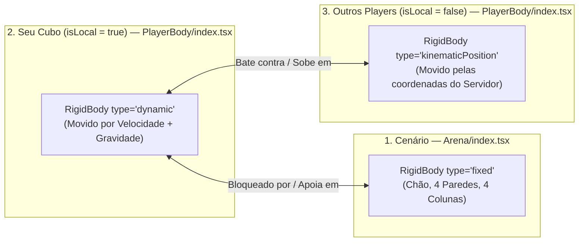
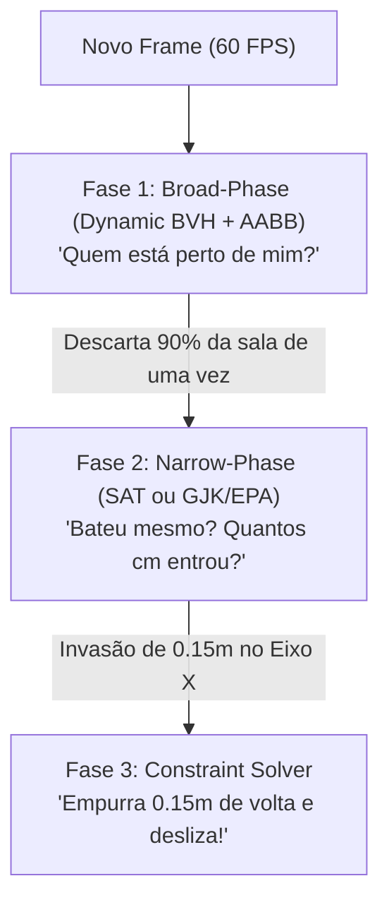

# Guia Completo: Movimentação (`WASD` + Pulo) e Algoritmo de Colisão do Rapier (SAT)

Este documento explica:
1. **O que mudou** na física da sala 3D e como funcionam a movimentação (`WASD`), o pulo (`Espaço`) e os colliders do `@react-three/rapier`.
2. **Como o Rapier calcula colisões por baixo dos panos** usando o algoritmo **SAT (*Separating Axis Theorem*)**, com a analogia das sombras e um passo a passo matemático com os números reais da nossa sala.

---

## Parte 1 — Como Funciona a Movimentação e a Colisão no Projeto

### 1.1. Antes vs. Depois

| Aspecto | Como era Antes (Cálculo Manual no Backend) | Como funciona Agora (Rapier no Frontend) |
| :--- | :--- | :--- |
| **Quem move o cubo local?** | O frontend mandava `{ x: 1, z: 0 }` a cada `50ms` e esperava o servidor somar `+ 0.2` e devolver a posição. | O Rapier move o seu cubo **instantaneamente a 60+ FPS** no navegador através de velocidade física (`body.setLinvel`). |
| **Colisão com Paredes e Chão** | Era apenas um `Math.min(9.5, Math.max(-9.5, valor))` (`clampToFloor`) no backend. Ignorava objetos internos da cena. | Feita por `<CuboidCollider>` reais na [`Arena`](file:///home/user/rooms/frontend/src/pages/Room/components/Arena/index.tsx). Colide com o chão, as 4 paredes e as **4 colunas dos cantos**. |
| **Colisão entre Players** | Conta manual 2D (`canOccupy`) só nos eixos `X` e `Z` no backend. Não permitia pular em cima de outro player. | Colisão 3D real no Rapier: seu cubo (`dynamic`) bate nas laterais e também consegue **pular em cima** dos outros cubos (`kinematicPosition`). |
| **Pulo e Gravidade** | Gravidade do Rapier desligada (`[0, 0, 0]`). O backend rodava um `setInterval` somando/subtraindo `player.y`. | Gravidade real no Rapier (`gravity={[0, -20, 0]}`) em [`RoomScene`](file:///home/user/rooms/frontend/src/pages/Room/components/RoomScene/index.tsx#L40) + sensor físico de chão (`intersectionWithShape`). |
| **Papel do Backend ([`EnglishRoom.ts`](file:///home/user/rooms/backend/src/colyseus/EnglishRoom.ts))** | Fazia todas as contas de colisão e gravidade. | Define o spawn inicial livre (`findSpawnPosition`) e **repassa** as coordenadas `{ x, y, z }` resolvidas pelo Rapier para os demais jogadores. |

---

### 1.2. Os 3 tipos de `RigidBody` na Sala 3D



1. **`type="fixed"` ([`Arena/index.tsx`](file:///home/user/rooms/frontend/src/pages/Room/components/Arena/index.tsx#L21)):** Objetos imóveis (chão, 4 paredes e 4 colunas). Bloqueiam qualquer corpo `dynamic`.
2. **`type="dynamic"` ([`PlayerBody/index.tsx`](file:///home/user/rooms/frontend/src/pages/Room/components/PlayerBody/index.tsx#L92) quando `isLocal === true`):** É o **seu cubo**. Sofre gravidade (`[0, -20, 0]`), recebe velocidade pelo teclado (`body.setLinvel`) e colide contra tudo (`fixed` e `kinematicPosition`).
3. **`type="kinematicPosition"` ([`PlayerBody/index.tsx`](file:///home/user/rooms/frontend/src/pages/Room/components/PlayerBody/index.tsx#L92) quando `isLocal === false`):** São os **outros jogadores**, movidos suavemente (`MathUtils.lerp` + `setNextKinematicTranslation`) para as coordenadas enviadas pelo servidor. Funcionam como obstáculos sólidos para o seu cubo `dynamic`.

---

### 1.3. Movimentação Horizontal (`WASD`) e Pulo (`Espaço`)

1. **`WASD` → Velocidade (`vx`, `vz`):**
   - [`useHotkeys.tsx`](file:///home/user/rooms/frontend/src/pages/Room/hooks/useHotkeys.tsx#L17-L46) atualiza `movementRef.current` (`forward`, `backward`, `left`, `right`).
   - [`computeHorizontalVelocity`](file:///home/user/rooms/frontend/src/pages/Room/components/PlayerBody/helpers.ts#L12-L27) multiplica a direção (`-1`, `0` ou `+1`) por `playerMoveSpeed` (`4.5` m/s).
   - No `useFrame` de [`PlayerBody/index.tsx`](file:///home/user/rooms/frontend/src/pages/Room/components/PlayerBody/index.tsx#L42-L76), chamamos `body.setLinvel({ x: vx, y: nextVy, z: vz }, true)`.
2. **`Espaço` → Sensor Físico de Chão (`world.intersectionWithShape`):**
   - Quando você aperta `Espaço`, `jumpRequestedRef.current` vira `true`.
   - Em [`PlayerBody/index.tsx`](file:///home/user/rooms/frontend/src/pages/Room/components/PlayerBody/index.tsx#L47-L68), o Rapier testa uma caixa fina (`0.9m x 0.08m x 0.9m`) posicionada `3cm` abaixo da base do seu cubo (`current.y - playerHalfSize - 0.03`), ignorando o próprio `body` do jogador.
   - Se essa caixa tocar qualquer outro collider (chão ou topo de outro jogador) e `Math.abs(currentVel.y) <= 0.5`, aplicamos `nextVy = playerJumpVelocity` (`7.5` m/s).

---

## Parte 2 — Como o Rapier Calcula Colisões por Baixo dos Panos (BVH, SAT e Afins)

O Rapier é escrito em **Rust** (executado via **WebAssembly**) e usa a biblioteca geométrica `parry3d`. A cada frame, ele roda **3 fases** em sequência:



---

### 2.0. O que são AABB, Dynamic BVH, GJK/EPA e CCD? (Glossário Descomplicado)

Antes de chegar no cálculo exato da batida (SAT), o Rapier usa estruturas inteligentes para não derreter o processador testando objetos que estão longe um do outro:

#### 1. O que é uma `AABB` (*Axis-Aligned Bounding Box*)? — A "Caixa de Sapato Invisível"
Se você colocar uma cadeira cheia de curvas ou um objeto inclinado na sala, calcular a colisão direto nas curvas é pesado.
Por isso, o Rapier envolve cada objeto em uma **"caixa de sapato invisível" sempre reta (alinhada aos eixos X, Y, Z)** chamada **AABB**.
- Se a sua caixa de sapato nem encostou na caixa de sapato da cadeira, o Rapier nem perde tempo testando a geometria real.

#### 2. O que é o `BVH` (*Bounding Volume Hierarchy*)? — "Caixas Grandes que guardam Caixas Menores"
Imagine que a sala tenha **100 objetos**. Mesmo com caixas de sapato (AABBs), testar você contra 100 objetos um por um a cada frame daria milhares de testes.
O **BVH** agrupa as caixas de sapato em uma árvore hierárquica (igual a País → Estado → Bairro → Casa):
- **Caixa Gigante Esquerda:** Engloba tudo que está na metade esquerda da sala (Parede Esquerda, Colunas da Esquerda, Mesas da Esquerda).
- **Caixa Gigante Direita:** Engloba tudo que está na metade direita da sala.

Quando você está andando lá no **lado direito**, o Rapier faz **1 única pergunta**:
> *"O jogador encostou na Caixa Gigante da Esquerda?"* → **Não!**

Com **1 único teste**, ele descarta todos os 50 objetos do lado esquerdo de uma vez só, sem olhar nenhum deles!

#### 3. Por que se chama `Dynamic BVH` (BVH Dinâmico)? — A "Caixa com Folga"
As paredes são fixas, mas você e os outros players se mexem o tempo todo. Se o Rapier tivesse que reconstruir a árvore inteira do zero a cada milímetro que você anda, ficaria lento.
- O **Dynamic BVH** coloca em volta do seu cubo uma **AABB Folgada (*Fattened AABB*)**, um pouquinho maior que o seu cubo real.
- Enquanto você dá passinhos dentro dessa folga, a árvore continua intacta. Só quando você atravessa a borda dessa folga é que o Rapier atualiza apenas aquele galho da árvore.

#### 4. Resumo dos outros termos ("e afins")
| Sigla / Nome | Nome Completo | Para que serve em 1 frase |
| :--- | :--- | :--- |
| **AABB** | *Axis-Aligned Bounding Box* | A "caixa de sapato" invisível em volta de cada objeto para testes rápidos. |
| **Dynamic BVH** | *Dynamic Bounding Volume Hierarchy* | A árvore que agrupa a sala em regiões maiores para descartar objetos distantes de uma vez só. |
| **SAT** | *Separating Axis Theorem* | O teste das "sombras na parede" que calcula a batida exata entre duas caixas (`CuboidCollider`). |
| **GJK + EPA** | *Gilbert-Johnson-Keerthi / Expanding Polytope* | O substituto do SAT quando você usa formas redondas (`BallCollider`, `CapsuleCollider`, `CylinderCollider`). |
| **CCD** | *Continuous Collision Detection* | O "radar anti-teleporte" que impede o cubo de atravessar paredes finas se o FPS cair bruscamente. |
| **Solver** | *Sequential Impulse Constraint Solver* | O "juiz" final que recebe o resultado do SAT (*"entrou 0.15m em X"*) e empurra o cubo para fora da parede. |

---

### 2.1. Entendendo o Algoritmo SAT: A Analogia da Lanterna e das Sombras

Imagine dois cubos flutuando no ar dentro de uma sala escura: o **Cubo A (Você)** e o **Cubo B (Outro Player ou uma Coluna)**.
Como o computador descobre se esses dois cubos estão se tocando?

Ele acende uma "lanterna" apontando para cada eixo (**Eixo X**, **Eixo Y** e **Eixo Z**) e olha para as **sombras** (projeções 1D) que os dois cubos fazem na parede de cada eixo:

```text
Olhando a sombra no EIXO X (Caso 1: NÃO colidiu — existe luz entre as sombras):
   [ Sombra do Cubo A ]     <-- espaço vazio -->     [ Sombra do Cubo B ]
----------|---------------------|------------------------|----------
         0.5                   1.5                      2.0

Olhando a sombra no EIXO X (Caso 2: Sombras se cruzaram!):
          [ Sombra do Cubo A ]
                        [ Sombra do Cubo B ]
-----------------|-------------|--------------|---------------------
                0.65          1.50           1.65
                               |<-- 0.15m --->| (invasão!)
```

**A Regra de Ouro do SAT:**
- Se em **pelo menos 1 eixo** (X, Y **ou** Z) existir um **espaço vazio** entre as sombras, é 100% garantido que os objetos **não estão colidindo**.
- Para dois cubos colidirem no espaço 3D, **as sombras deles precisam se sobrepor nos 3 eixos (X, Y e Z) ao mesmo tempo!**
*(Nota: se um dos cubos estivesse rotacionado no ar, o SAT testaria até 15 eixos: 3 normais de A + 3 normais de B + 9 produtos vetoriais das arestas. Como nossos cubos têm rotação travada `enabledRotations={[false, false, false]}`, os eixos são exatamente X, Y e Z).*

---

### 2.2. Passo a Passo com os Números Reais da nossa Sala

Vamos acompanhar exatamente a conta que o Rapier faz quando você anda na diagonal (`W + D`) e encosta na lateral de outro jogador.
Cada cubo tem `1.0m` de largura (`meio-tamanho = 0.5m` para cada lado a partir do centro):

- **Cubo B (Outro Player parado)** está em `(x = 2.0, y = 0.5, z = 0.0)`:
  - Sombra no **Eixo X**: `2.0 ± 0.5` → vai de **`1.50` até `2.50`**
  - Sombra no **Eixo Y**: `0.5 ± 0.5` → vai de **`0.00` até `1.00`**
  - Sombra no **Eixo Z**: `0.0 ± 0.5` → vai de **`-0.50` até `+0.50`**

- **Cubo A (Você andando com `W + D`)** tenta se mover nesse frame para `(x = 1.15, y = 0.5, z = 0.2)`:
  - Sombra no **Eixo X**: `1.15 ± 0.5` → vai de **`0.65` até `1.65`**
  - Sombra no **Eixo Y**: `0.5 ± 0.5` → vai de **`0.00` até `1.00`**
  - Sombra no **Eixo Z**: `0.2 ± 0.5` → vai de **`-0.30` até `+0.70`**

Agora o Rapier executa **3 passos matemáticos**:

#### Passo 1: Medir quanto uma sombra invadiu a outra em cada eixo
1. **No Eixo X:** Sua sombra vai até `1.65`, mas a do Cubo B já começa em `1.50`.
   - **Invasão em X** = `1.65 - 1.50` = **`0.15m`**
2. **No Eixo Y:** Os dois estão na mesma altura (`0.00` até `1.00`).
   - **Invasão em Y** = `1.00 - 0.00` = **`1.00m`**
3. **No Eixo Z:** Sua sombra começa em `-0.30` e a do Cubo B vai até `+0.50`.
   - **Invasão em Z** = `0.50 - (-0.30)` = **`0.80m`**

Como houve invasão positiva nos 3 eixos (`X > 0`, `Y > 0` e `Z > 0`), o SAT confirma: **HOUVE COLISÃO!**

---

#### Passo 2: Descobrir por qual lado você bateu (O Eixo de Menor Penetração)
Agora o Rapier compara os 3 tamanhos de invasão encontrados no Passo 1:
- Invasão em **X**: **`0.15m`** 👈 *(Menor valor!)*
- Invasão em **Y**: `1.00m`
- Invasão em **Z**: `0.80m`

O SAT escolhe **sempre o eixo com a menor invasão** (`0.15m` no Eixo X).
Por quê? Porque o caminho mais curto para separar os dois cubos é empurrar você `0.15m` de volta para a esquerda no Eixo X (e não jogar você `1.00m` para cima no Eixo Y). Assim, o Rapier descobre automaticamente que a batida aconteceu **na parede lateral X** do outro cubo!

> **E quando você PULA em cima da cabeça de outro cubo?**
> Quando você está caindo por cima do Cubo B, as sombras em `X` e `Z` estão quase todas sobrepostas (ex.: `0.90m`), mas a sola do seu cubo acabou de entrar só um pouquinho no topo do Cubo B no **Eixo Y** (ex.: **`0.03m` em Y**).
> Nesse caso, a **menor invasão é no Eixo Y (`0.03m`)**! O Rapier entende na hora que o contato é vertical (no topo), empurra seu cubo `0.03m` para cima (`+Y`) e deixa você em pé em cima do outro jogador!

---

#### Passo 3: Resolver a Física e Deslizar (O Solver)
Sabendo que a menor invasão foi **`0.15m` no Eixo X**:
1. **Corrige a posição:** O Rapier recua o seu `x` em `0.15m` (`1.15 - 0.15 = 1.00`). A face direita do seu cubo (`1.00 + 0.5 = 1.50`) fica encostada exatamente na face esquerda do outro cubo (`1.50`).
2. **Deslizamento lateral (`friction={0}`):** O Solver zera a sua velocidade apenas no eixo da batida (`vx = 0`), mas mantém a sua velocidade `vz` livre. Por isso, segurando `W + D` contra uma parede ou outro cubo, você não trava seco — seu cubo desliza suavemente pelo eixo livre (`Z`)!
