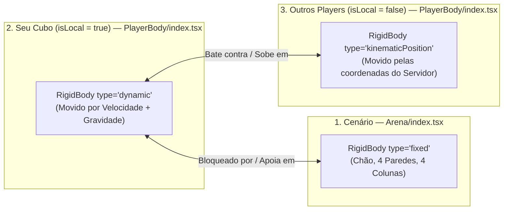
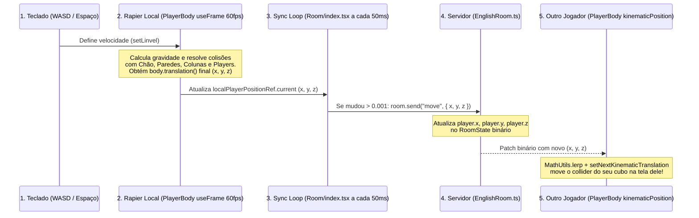

# Guia de Movimentação (`WASD` + Pulo) e Validação de Colisão com Rapier

Este documento explica **o que mudou** na arquitetura de física da sala 3D e **como funcionam agora a movimentação (`WASD`), o pulo (`Espaço`) e a validação de colisões** usando o motor de física **`@react-three/rapier`**.

---

## 1. O que mudou? (Antes vs. Depois)

| Aspecto | Como era Antes (Cálculo Manual no Backend) | Como funciona Agora (Rapier no Frontend) |
| :--- | :--- | :--- |
| **Quem move o cubo local?** | O frontend mandava apenas `{ x: 1, z: 0 }` a cada `50ms` e esperava o servidor somar `+ 0.2` e devolver a posição. | O Rapier move o seu cubo **instantaneamente a 60+ FPS** no navegador através de velocidade física (`body.setLinvel`). |
| **Colisão com Paredes e Chão** | Era apenas um `Math.min(9.5, Math.max(-9.5, valor))` (`clampToFloor`) no backend. Ignorava objetos internos da cena. | Feita por `<CuboidCollider>` reais na [`Arena`](file:///home/user/rooms/frontend/src/pages/Room/components/Arena/index.tsx). Colide com o chão, as 4 paredes e as **4 colunas dos cantos**. |
| **Colisão entre Players** | Conta manual de quadrado 2D (`canOccupy`) só nos eixos `X` e `Z` no backend. Não permitia subir/pular em cima de outro player. | Colisão 3D real no Rapier: seu cubo (`dynamic`) bate nas laterais e também consegue **pular em cima** dos outros cubos (`kinematicPosition`). |
| **Pulo e Gravidade** | Gravidade do Rapier desligada (`[0, 0, 0]`). O backend rodava um `setInterval` somando/subtraindo `player.y`. | Gravidade real no Rapier (`gravity={[0, -20, 0]}`) em [`RoomScene`](file:///home/user/rooms/frontend/src/pages/Room/components/RoomScene/index.tsx#L40) + checagem física de contato com o chão (`intersectionWithShape`). |
| **Papel do Backend ([`EnglishRoom.ts`](file:///home/user/rooms/backend/src/colyseus/EnglishRoom.ts))** | Fazia todas as contas de colisão e gravidade. | Define o spawn inicial sem sobreposição (`findSpawnPosition`) e **sincroniza** as coordenadas `{ x, y, z }` resolvidas pelo Rapier para os demais jogadores. |

---

## 2. Os 3 tipos de Corpos Físicos (`RigidBody`) na Cena

Para que a colisão funcione perfeitamente em um ambiente multiplayer, o Rapier classifica cada objeto da sala em um dos **3 tipos de `RigidBody`**:



1. **`type="fixed"` ([`Arena/index.tsx`](file:///home/user/rooms/frontend/src/pages/Room/components/Arena/index.tsx#L21)):**
   - Objetos estáticos que **nunca se movem** e têm massa infinita (chão, paredes, colunas).
   - Quando um corpo `dynamic` tenta atravessá-los, o Rapier bloqueia o movimento imediatamente.
2. **`type="dynamic"` ([`PlayerBody/index.tsx`](file:///home/user/rooms/frontend/src/pages/Room/components/PlayerBody/index.tsx#L92) quando `isLocal === true`):**
   - É o **seu próprio jogador**.
   - Sofre ação da gravidade (`[0, -20, 0]`), é movido aplicando velocidade (`setLinvel`) e **respeita todas as colisões** com corpos `fixed` e `kinematicPosition`.
3. **`type="kinematicPosition"` ([`PlayerBody/index.tsx`](file:///home/user/rooms/frontend/src/pages/Room/components/PlayerBody/index.tsx#L92) quando `isLocal === false`):**
   - São os **outros jogadores** conectados na sala.
   - A posição deles vem do servidor (`player.x, player.y, player.z`), interpolada suavemente com `MathUtils.lerp` e aplicada via `body.setNextKinematicTranslation(...)`.
   - Para o Rapier, um corpo `kinematicPosition` funciona como uma **parede móvel sólida**: o seu cubo `dynamic` não consegue atravessá-los e pode inclusive subir em cima deles.

---

## 3. Como funciona a Movimentação Horizontal (`WASD`)

O fluxo do movimento horizontal acontece a cada frame do monitor (`useFrame`, 60+ FPS) em 3 passos:

### Passo 1: Captura das teclas (`useHotkeys.tsx`)
Em [`useHotkeys.tsx`](file:///home/user/rooms/frontend/src/pages/Room/hooks/useHotkeys.tsx#L17-L46), segurar ou soltar `W`, `A`, `S`, `D` atualiza instantaneamente o objeto `movementRef.current`:
```ts
movementRef.current = {
  forward: true,   // W pressionado
  backward: false, // S solto
  left: false,     // A solto
  right: false,    // D solto
};
```

### Passo 2: Conversão para Velocidade Física (`PlayerBody/helpers.ts`)
Em [`PlayerBody/helpers.ts`](file:///home/user/rooms/frontend/src/pages/Room/components/PlayerBody/helpers.ts#L12-L27), a função [`computeHorizontalVelocity`](file:///home/user/rooms/frontend/src/pages/Room/components/PlayerBody/helpers.ts#L12) transforma os booleanos em velocidade em metros/unidades por segundo (`playerMoveSpeed = 4.5`):
```ts
const dirX = Number(movement.right) - Number(movement.left);       // -1 (esquerda), 0 (parado), +1 (direita)
const dirZ = Number(movement.backward) - Number(movement.forward); // -1 (frente/W), 0 (parado), +1 (trás/S)

return {
  vx: dirX * playerMoveSpeed, // Ex: 0 * 4.5 = 0
  vz: dirZ * playerMoveSpeed, // Ex: -1 * 4.5 = -4.5 m/s
};
```

### Passo 3: Aplicação no Motor de Física (`PlayerBody/index.tsx`)
Dentro do `useFrame` em [`PlayerBody/index.tsx`](file:///home/user/rooms/frontend/src/pages/Room/components/PlayerBody/index.tsx#L42-L76), nós **não mudamos `x` e `z` na mão**. Em vez disso, entregamos a velocidade desejada para o Rapier:
```ts
const { vx, vz } = computeHorizontalVelocity(movementRef?.current);
const currentVel = body.linvel(); // Lê a velocidade atual (para preservar a velocidade Y da gravidade/pulo)

body.setLinvel({ x: vx, y: nextVy, z: vz }, true);
```
> **O que acontece quando você solta as teclas?**
> Assim que você solta `W`, `vx` e `vz` viram `0`. Como passamos `{ x: 0, y: nextVy, z: 0 }` no `setLinvel`, o cubo para imediatamente sem continuar "escorregando como no gelo".

---

## 4. Como funciona o Pulo (`Espaço`) e a Validação de Chão

Em um motor de física real, não basta checar `if (player.y === 0.5)` para deixar o jogador pular — porque o jogador pode estar em cima de outro cubo (`y = 1.5`) ou em cima de um obstáculo mais alto.

Por isso, o pulo funciona assim:

### Passo 1: Sinalização do Pulo (`useHotkeys` → `jumpRequestedRef`)
Quando você aperta `Espaço` (sem repetição de tecla segurada, `!event.repeat`), o callback `onJump` em [`Room/index.tsx`](file:///home/user/rooms/frontend/src/pages/Room/index.tsx#L62-L64) marca:
```ts
jumpRequestedRef.current = true;
```

### Passo 2: Sensor Físico de Chão (`world.intersectionWithShape`)
No frame seguinte, dentro do `useFrame` do [`PlayerBody/index.tsx`](file:///home/user/rooms/frontend/src/pages/Room/components/PlayerBody/index.tsx#L47-L68), o código consome o pedido (`jumpRequestedRef.current = false`) e pergunta ao mundo físico do Rapier: **"Existe algum collider sólido logo abaixo da sola do meu cubo?"**:

```ts
// Cria uma "fatia" fina (0.9m x 0.08m x 0.9m) para testar abaixo do cubo
const groundShape = new rapier.Cuboid(
  playerHalfSize * 0.9, // 0.45 de meia-largura (um pouquinho menor que 0.5 para não detectar parede lateral!)
  0.04,                 // 0.04 de meia-altura
  playerHalfSize * 0.9, // 0.45 de meia-profundidade
);

// Posiciona essa fatia 3cm abaixo da face inferior do cubo (current.y - 0.5 - 0.03)
const groundHit = world.intersectionWithShape(
  { x: current.x, y: current.y - playerHalfSize - 0.03, z: current.z },
  { x: 0, y: 0, z: 0, w: 1 },
  groundShape,
  undefined,
  undefined,
  undefined,
  body, // <-- IMPORTANTE: ignora o próprio RigidBody do jogador!
);
```

### Por que esse `groundShape` tem largura `0.9 * playerHalfSize` (`0.45`) em vez de `0.5`?
Se a caixa de checagem tivesse exatamente `0.5` de meia-largura e você estivesse **encostado numa parede vertical**, a lateral da caixa tocaria na parede e o jogo acharia que a parede é chão (permitindo escalar paredes pulando infinitamente!). Fazendo ela `10%` mais estreita (`0.45`), ela só detecta superfícies que estão realmente **embaixo** do cubo, mas ainda permite pular mesmo quando você está na beirada do topo de outro jogador!

### Passo 3: Impulso Vertical e Gravidade
Se `groundHit !== null` (há chão/objeto embaixo) e `Math.abs(currentVel.y) <= 0.5`:
1. Definimos `nextVy = playerJumpVelocity` (`7.5` m/s para cima).
2. Nos frames seguintes, o `<Physics gravity={[0, -20, 0]}>` do Rapier desacelera `linvel.y` automaticamente até `0` no topo do pulo e puxa o cubo de volta para baixo até colidir com o `<CuboidCollider>` do chão (ou de outro player).

---

## 5. Como funciona a Validação de Colisão no Rapier (Por Baixo dos Panos)

Aqui estão as configurações críticas em [`Arena/index.tsx`](file:///home/user/rooms/frontend/src/pages/Room/components/Arena/index.tsx) e [`PlayerBody/index.tsx`](file:///home/user/rooms/frontend/src/pages/Room/components/PlayerBody/index.tsx) que garantem uma colisão limpa e sem bugs:

### 1. Onde estão os Colliders da Arena? ([`Arena/index.tsx`](file:///home/user/rooms/frontend/src/pages/Room/components/Arena/index.tsx#L21-L34))
Dentro do `<RigidBody type="fixed" colliders={false} position={[0, 0, 0]} friction={0}>`, temos **9 colliders retangulares (`CuboidCollider`)**:
- **1 para o Chão:** `args={[10, 0.05, 10]}` em `position={[0, -0.05, 0]}`. Como a meia-altura é `0.05` e o centro está em `-0.05`, a superfície superior do chão fica exatamente em **`Y = 0.0`**.
- **4 para as Paredes Externas:** Nas bordas `Z = -10`, `Z = +10`, `X = -10` e `X = +10`, com altura `4` (`wallHeight / 2 = 2`) e espessura `0.4` (`wallThickness / 2 = 0.2`).
- **4 para as Colunas dos Cantos:** Gerados pelo `.map` em `columnPositions` (`[±9.2, 1.6, ±9.2]`), com meia-largura `0.275` (`0.55 / 2`) e meia-altura `1.6` (`3.2 / 2`).

> **Nota sobre `args` no `<CuboidCollider>`:**
> No Three.js (`<boxGeometry args={[largura, altura, profundidade]} />`), você passa o tamanho inteiro (`1, 1, 1`).
> Já no Rapier (`<CuboidCollider args={[meiaLargura, meiaAltura, meiaProfundidade]} />`), você sempre passa a **metade do tamanho (half-extents)** (`0.5, 0.5, 0.5`).

### 2. Por que `enabledRotations={[false, false, false]}` no `PlayerBody`?
Por padrão, se um cubo `dynamic` no Rapier bater na quina de uma coluna ou cair na beirada de outro cubo, a física real faria o cubo **capotar/rolar no chão**. Travando as rotações nos 3 eixos (`[false, false, false]`), o cubo desliza e colide como um personagem de jogo, mantendo-se sempre em pé.

### 3. Por que `friction={0}` no `<CuboidCollider>` do Player e da Arena?
Se `friction` (atrito) for maior que zero, quando você pula em direção a uma parede e continua segurando `W` no ar, a força que você faz contra a parede gera atrito vertical e **o cubo fica "grudado" na parede sem cair**!
Com `friction={0}`, se você andar na diagonal contra uma parede ou pular encostado nela, o cubo desliza suavemente pela parede sem travar.

### 4. Por que `ccd={isLocal}` (Continuous Collision Detection)?
`ccd` ativa a detecção contínua de colisão no seu cubo. Isso garante que, mesmo se houver uma queda brusca de FPS no navegador, o cubo nunca atravesse uma parede fina ou outro jogador entre um frame e outro.

---

## 6. Sincronização Física com o Colyseus (`Frontend` → `Backend` → `Outros Players`)

Veja o ciclo completo de como a posição validada pelo Rapier no seu navegador chega aos outros jogadores:



1. **No final de cada frame físico ([`PlayerBody/index.tsx`](file:///home/user/rooms/frontend/src/pages/Room/components/PlayerBody/index.tsx#L70-L74)):**
   Lemos `const current = body.translation()` (que já é a coordenada **pós-colisão** do Rapier) e salvamos em `localPlayerPositionRef.current`.
2. **A cada `50ms` ([`Room/index.tsx`](file:///home/user/rooms/frontend/src/pages/Room/index.tsx#L195-L216)):**
   A função [`hasPositionChanged`](file:///home/user/rooms/frontend/src/pages/Room/helpers.ts#L15-L21) compara `localPlayerPositionRef.current` com a última posição enviada (`lastSentPositionRef.current`).
   - Se você estiver parado (`diferença <= 0.001`), **nenhum pacote é enviado** pela rede (economiza banda e CPU).
   - Se você se moveu ou está no meio de um pulo, envia `room.send('move', { x, y, z })`.
3. **No Servidor ([`EnglishRoom.ts`](file:///home/user/rooms/backend/src/colyseus/EnglishRoom.ts#L56-L74)):**
   O servidor grava `player.x`, `player.y` e `player.z` no `RoomState`, e o Colyseus replica automaticamente para os demais clientes na sala.
