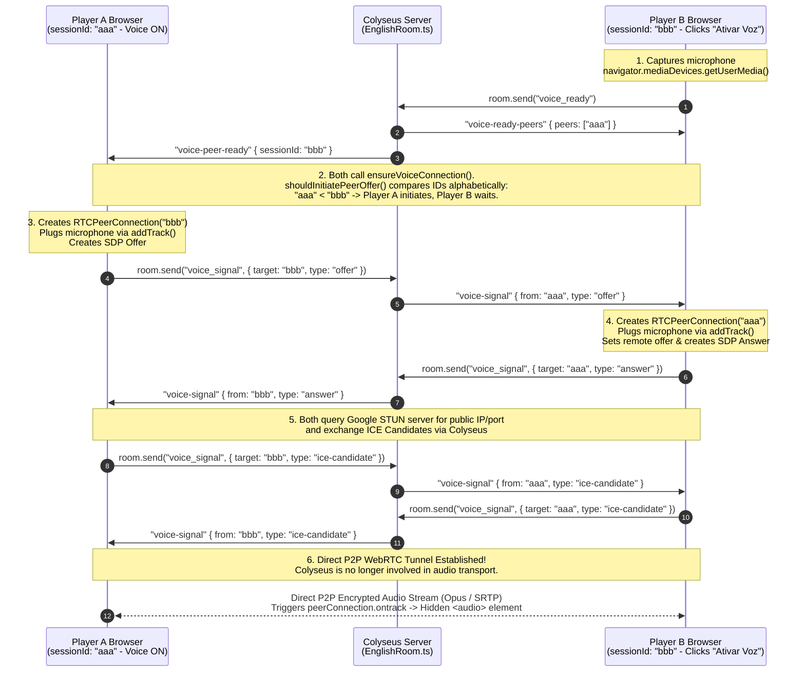
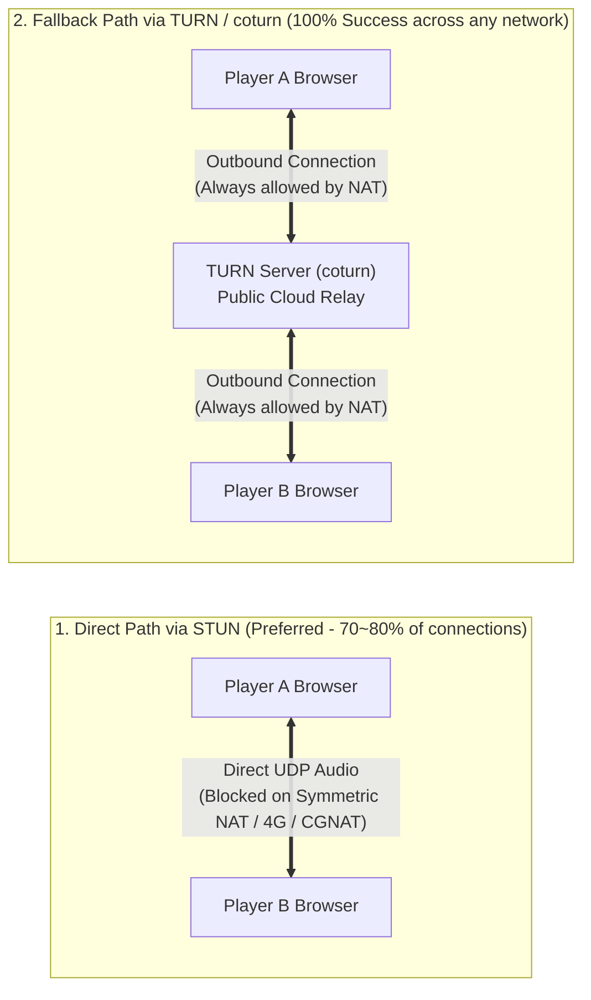

# Complete Guide: How Proximity Voice Chat Works (WebRTC + Colyseus WebSocket)

This document provides a complete, step-by-step explanation of how the **Proximity Voice Chat** system works in this project, from the moment a player's microphone is captured in the browser to how audio streams directly to other players and fades with 3D distance.

---

## 1. High-Level Architecture

The voice chat combines three distinct mechanisms:

1. **Local Audio Capture (`MediaDevices.getUserMedia`)**: Captures the player's physical microphone in the browser with built-in audio processing (`echoCancellation`, `noiseSuppression`, `autoGainControl`).
2. **WebSocket Signaling (`Colyseus` / `EnglishRoom`)**: Acts as the "phonebook/operator" (like sending a text message to coordinate a phone call). The Colyseus server **never processes or relays voice audio bytes**; it only relays lightweight JSON signaling messages (`voice_ready`, `voice_disabled`, `voice_signal`) so browsers can find each other.
3. **Peer-to-Peer Audio Streaming & Spatial Volume (`WebRTC` + 3D Proximity)**: Once two browsers exchange connection details via Colyseus, they open a direct **WebRTC (`RTCPeerConnection`)** tunnel between each other. Every `100ms`, the receiving browser adjusts the volume of each remote player's hidden `<audio>` element based on the 3D distance between their cubes on the `XZ` plane.

### Architecture & Signaling Sequence Diagram



---

## 2. File Structure Overview

| File | Responsibility |
| :--- | :--- |
| [`frontend/src/pages/Room/components/VoiceChatControls/index.tsx`](../frontend/src/pages/Room/components/VoiceChatControls/index.tsx) | Main React component managing microphone capture, `RTCPeerConnection` lifecycle, Colyseus signaling listeners, hidden `<audio>` elements, and the `100ms` proximity volume loop. |
| [`frontend/src/pages/Room/components/VoiceChatControls/helpers.ts`](../frontend/src/pages/Room/components/VoiceChatControls/helpers.ts) | Pure helper functions: `computeProximityVolume` (quadratic distance falloff) and `shouldInitiatePeerOffer` (alphabetical ID tie-breaker to prevent offer collisions). |
| [`frontend/src/pages/Room/components/VoiceChatControls/consts.ts`](../frontend/src/pages/Room/components/VoiceChatControls/consts.ts) | Constants: `maxVoiceDistance = 14` and `rtcConfiguration` (Google public STUN server + TURN server configured via `VITE_TURN_*` env vars). |
| [`frontend/src/pages/Room/components/VoiceChatControls/types.ts`](../frontend/src/pages/Room/components/VoiceChatControls/types.ts) | TypeScript types for `VoiceChatControlsProps` and `VoiceSignalPayload` (`offer`, `answer`, `ice-candidate`). |
| [`backend/src/colyseus/EnglishRoom.ts`](../backend/src/colyseus/EnglishRoom.ts) | Tracks `voiceReadyClients` (`Set<string>`) and relays `voice_ready`, `voice_disabled`, and `voice_signal` messages between room participants. |

---

## 3. End-to-End Voice Flow: From Microphone Capture to Peer Playback

To make the asynchronous WebRTC handshake easy to follow, let's trace a concrete scenario with **2 players**:
- **Player A (`sessionId: "aaa"`)**: Already in the room with voice enabled.
- **Player B (`sessionId: "bbb"`)**: Just clicked the **"Ativar Voz"** button.

---

### Step 1: Capturing the Microphone Locally (`MediaStream`)

When **Player B** clicks **"Ativar Voz"**, `toggleVoiceChat` in [`VoiceChatControls/index.tsx`](../frontend/src/pages/Room/components/VoiceChatControls/index.tsx) requests microphone access from the browser:

```ts
const stream = await navigator.mediaDevices.getUserMedia({
  audio: {
    echoCancellation: true,
    noiseSuppression: true,
    autoGainControl: true,
  },
});

localStreamRef.current = stream;
voiceEnabledRef.current = true;
setVoiceEnabled(true);
setVoiceStatus('Voz por proximidade ativada.');
room.send('voice_ready');
```

- The browser opens the audio hardware, applies echo cancellation, noise suppression, and auto-gain, and returns a live `MediaStream` containing an audio `MediaStreamTrack`.
- This stream is stored in `localStreamRef.current`. At this exact moment, audio is being captured in local memory, but is not yet being transmitted anywhere.
- Immediately after, Player B notifies the Colyseus WebSocket server via `room.send('voice_ready')`.

---

### Step 2: Peer Discovery via the Colyseus WebSocket Server

When [`EnglishRoom.ts`](../backend/src/colyseus/EnglishRoom.ts) receives `'voice_ready'` from **Player B (`"bbb"`)**:

```ts
this.onMessage("voice_ready", (client) => {
  if (this.voiceReadyClients.has(client.sessionId)) {
    return;
  }

  this.voiceReadyClients.add(client.sessionId);

  client.send("voice-ready-peers", {
    peers: [...this.voiceReadyClients].filter((sessionId) => sessionId !== client.sessionId),
  });

  this.broadcast("voice-peer-ready", { sessionId: client.sessionId }, { except: client });
});
```

1. The server adds `"bbb"` to `this.voiceReadyClients`.
2. It sends `"voice-ready-peers"` directly to **Player B** with `{ peers: ["aaa"] }` ("Here is everyone who already has their mic on").
3. It broadcasts `"voice-peer-ready"` to **Player A** with `{ sessionId: "bbb" }` ("Player B just turned their mic on").

On the frontend, receiving either message triggers `ensureVoiceConnection(peerSessionId)` on **both** Player A's browser and Player B's browser.

---

### Step 3: Deciding Who Calls Whom (Preventing Offer Glare)

Think of WebRTC like a direct phone call. If **Player A** and **Player B** both tried to dial each other at the exact same millisecond, the calls would collide (a problem known in WebRTC as *glare*).

To guarantee that only **one** side dials while the other waits to pick up, `ensureVoiceConnection` uses `shouldInitiatePeerOffer` ([`helpers.ts`](../frontend/src/pages/Room/components/VoiceChatControls/helpers.ts)):

```ts
export const shouldInitiatePeerOffer = (localSessionId: string, peerSessionId: string): boolean => {
  return localSessionId.localeCompare(peerSessionId) < 0;
};
```

- It compares the two `sessionId` strings alphabetically:
  - On **Player B's browser (`"bbb"`)**: `"bbb".localeCompare("aaa") < 0` is `false`. Player B stops right there (`if (!shouldInitiateOffer) return;`) and waits for Player A's call.
  - On **Player A's browser (`"aaa"`)**: `"aaa".localeCompare("bbb") < 0` is `true`. Player A takes the initiative to start the call!

---

### Step 4: Plugging the Microphone (`addTrack`) and Sending the Invite (`offer`)

Because **Player A (`"aaa"`)** is the initiator:

1. **Player A creates the WebRTC connection object** by calling `createPeerConnection("bbb")`:
   ```ts
   const peerConnection = new RTCPeerConnection(rtcConfiguration);

   if (localStreamRef.current) {
     localStreamRef.current.getTracks().forEach((track) => {
       peerConnection.addTrack(track, localStreamRef.current as MediaStream);
     });
   }
   ```
   > **Crucial step (`addTrack`)**: This is where Player A's microphone (`localStreamRef.current`) is physically plugged into the connection for Player B. It tells the browser's WebRTC engine: *"Once this tunnel to Player B is open, encode and stream audio from my microphone track into it."*

2. **Player A generates and sends an SDP `offer`**:
   ```ts
   const offer = await peerConnection.createOffer();
   await peerConnection.setLocalDescription(offer);

   sendVoiceSignal(peerSessionId, {
     type: 'offer',
     sdp: offer,
   });
   ```
   - What is an `offer`? It is a small text description (SDP — Session Description Protocol) stating: *"Hi Player B, I want to open a two-way audio channel with you using the Opus audio codec and SRTP encryption. Do you accept?"*
   - Since Player A doesn't have a direct connection to Player B yet, `sendVoiceSignal` sends this `offer` through the Colyseus WebSocket server (`room.send('voice_signal', ...)`), which forwards it to Player B.

---

### Step 5: Accepting the Invite (`answer`) and Plugging Player B's Microphone

**Player B (`"bbb"`)** receives the `'voice-signal'` message from Colyseus and runs `handleVoiceSignal`:

```ts
const peerConnection = createPeerConnection(peerSessionId);

if (payload.type === 'offer') {
  await peerConnection.setRemoteDescription(payload.sdp);

  const answer = await peerConnection.createAnswer();
  await peerConnection.setLocalDescription(answer);

  sendVoiceSignal(peerSessionId, {
    type: 'answer',
    sdp: answer,
  });
  return;
}
```

1. Calling `createPeerConnection("aaa")` creates Player B's end of the `RTCPeerConnection` and **plugs Player B's microphone into it via `addTrack`**.
2. `setRemoteDescription(payload.sdp)` saves Player A's invite.
3. `createAnswer()` generates Player B's confirmation (`answer`), saves it locally (`setLocalDescription`), and sends it back to Player A via Colyseus.
4. When **Player A** receives the `answer`, Player A runs `await peerConnection.setRemoteDescription(payload.sdp)`. Now both browsers agree on the audio format and encryption!

---

### Step 6: Exchanging Network Addresses (`ice-candidate` + STUN)

Now both browsers know *how* they will talk, but they still need to know *where* on the internet to send the UDP audio packets (since most players are behind home routers/NATs).

1. When `new RTCPeerConnection(rtcConfiguration)` was created, it was given the STUN and TURN servers defined in [`consts.ts`](../frontend/src/pages/Room/components/VoiceChatControls/consts.ts):
   ```ts
   export const rtcConfiguration: RTCConfiguration = {
     iceServers: [
       { urls: `stun:stun.l.google.com:19302` },
       {
         urls: `turn:${import.meta.env.VITE_TURN_SERVER}:${import.meta.env.VITE_TURN_PORT}`,
         username: import.meta.env.VITE_TURN_USERNAME,
         credential: import.meta.env.VITE_TURN_CREDENTIAL,
       },
     ],
   };
   ```
2. Behind the scenes, both browsers ask the STUN/TURN servers for their network paths ("What is my public IP/port, and what is my TURN relay address?").
3. Every time a browser discovers a network path (called an **ICE Candidate**), its `peerConnection.onicecandidate` callback fires automatically:
   ```ts
   peerConnection.onicecandidate = (event) => {
     if (!event.candidate) {
       return;
     }

     sendVoiceSignal(peerSessionId, {
       type: 'ice-candidate',
       candidate: event.candidate.toJSON(),
     });
   };
   ```
4. The candidate is forwarded through Colyseus to the other player, who registers it in `handleVoiceSignal`:
   ```ts
   if (payload.type === 'ice-candidate') {
     await peerConnection.addIceCandidate(payload.candidate);
   }
   ```

---

### Step 7: Direct P2P Audio Streaming & Playback (`ontrack`)

As soon as a matching pair of ICE candidates connects **Player A** and **Player B**:

1. **The direct P2P tunnel opens.** The Colyseus server is completely out of the loop. Each browser continuously encodes its microphone audio, encrypts it, and streams it directly to the other player's browser. (If there are 5 voice-enabled players in a room, each browser maintains 4 `RTCPeerConnection` instances in `peerConnectionsRef`).
2. **Receiving the remote voice stream (`ontrack`)**: When Player A's audio stream arrives at Player B's browser (and vice versa), `peerConnection.ontrack` fires:
   ```ts
   peerConnection.ontrack = (event) => {
     const [remoteStream] = event.streams;
     const audioElement = ensureRemoteAudioElement(peerSessionId);

     if (audioElement.srcObject !== remoteStream) {
       audioElement.srcObject = remoteStream;
     }

     void audioElement.play().catch(() => {
       setVoiceStatus('Clique em ativar voz para liberar o audio do navegador.');
     });
   };
   ```
3. `ensureRemoteAudioElement(peerSessionId)` creates a hidden `<audio autoplay playsinline style="display: none">` tag in `document.body` dedicated to that specific peer, attaches the incoming WebRTC `remoteStream` to `audioElement.srcObject`, and starts playback!

---

## 4. How 3D Proximity Volume Works

Notice that every player transmits their microphone audio at **100% volume**. Volume attenuation is calculated independently by **each receiving browser** based on how far apart the 3D cubes are.

1. **The 100ms Volume Update Loop**:
   In [`VoiceChatControls/index.tsx`](../frontend/src/pages/Room/components/VoiceChatControls/index.tsx), a `window.setInterval` runs every `100ms` (10 times per second) and calls `updateRemoteAudioVolumes()`:
   ```ts
   const updateRemoteAudioVolumes = useCallback(() => {
     const localSessionId = sessionIdRef.current;
     if (!localSessionId) return;

     const localPlayer = playersRef.current[localSessionId];
     if (!localPlayer) return;

     for (const [peerSessionId, audioElement] of remoteAudioElementsRef.current.entries()) {
       const remotePlayer = playersRef.current[peerSessionId];
       audioElement.volume = computeProximityVolume(localPlayer, remotePlayer);
     }
   }, []);
   ```

2. **Quadratic Distance Falloff (`computeProximityVolume`)**:
   In [`VoiceChatControls/helpers.ts`](../frontend/src/pages/Room/components/VoiceChatControls/helpers.ts), the horizontal distance on the `XZ` plane between the local cube and the remote player's cube is converted into a volume between `0.0` and `1.0`:
   ```ts
   export const computeProximityVolume = (localPlayer: Player, remotePlayer?: Player): number => {
     if (!remotePlayer) {
       return 0;
     }

     const dx = remotePlayer.x - localPlayer.x;
     const dz = remotePlayer.z - localPlayer.z;
     const distance = Math.hypot(dx, dz);
     const ratio = Math.max(0, 1 - distance / maxVoiceDistance);

     return ratio * ratio;
   };
   ```
   - `maxVoiceDistance` is `14` units ([`consts.ts`](../frontend/src/pages/Room/components/VoiceChatControls/consts.ts)).
   - Squaring `ratio` (`ratio * ratio`) creates a smooth, natural acoustic falloff:
     - **Distance = `0` units**: `volume = 1.0` (100% volume)
     - **Distance = `7` units (halfway)**: `ratio = 0.5` $\rightarrow$ `volume = 0.25` (25% volume)
     - **Distance $\ge$ `14` units**: `ratio = 0` $\rightarrow$ `volume = 0.0` (completely muted)

---

## 5. Disconnection & Cleanup Lifecycle

Connections and `<audio>` DOM elements are automatically cleaned up in four scenarios:

1. **Local Player Disables Voice**: Clicking **"Desativar Voz"** sends `room.send('voice_disabled')` and runs `resetVoiceState()`, which stops all local microphone tracks (`track.stop()`), closes all `RTCPeerConnection`s, and removes all hidden `<audio>` elements from `document.body`.
2. **Remote Player Disables Voice (`voice-peer-disabled`)**: When another player clicks **"Desativar Voz"**, the server broadcasts `'voice-peer-disabled'`, and all other browsers call `closeVoiceConnection(peerSessionId)` to close that specific `RTCPeerConnection` and remove their `<audio>` tag.
3. **Remote Player Leaves the Room (`voice-peer-left` / `players` state change)**: When a player disconnects from Colyseus, `onLeave` broadcasts `'voice-peer-left'` and removes the player from `state.players`. Both listeners invoke `closeVoiceConnection(peerSessionId)`.
4. **WebRTC Connection Failure**: If `peerConnection.onconnectionstatechange` reports `'failed'` or `'closed'`, `closeVoiceConnection(peerSessionId)` automatically cleans up the stale connection and audio element.

---

## 6. How to Read `VoiceChatControls/index.tsx` (Code Walkthrough)

When you first open [`VoiceChatControls/index.tsx`](../frontend/src/pages/Room/components/VoiceChatControls/index.tsx), the code can feel difficult to follow for two specific reasons:

1. **The file is written "bottom-up" (in reverse chronological order)**: Because React `useCallback` hooks must be declared before other hooks that depend on them, lines `30–68` start with **how to tear down and clean up connections**, the middle of the file defines helper functions, and **only at the bottom** (lines `245–354`) do you see the button click handler (`toggleVoiceChat`) and the Colyseus WebSocket listeners! Reading from line 1 to line 407 is like reading a recipe starting with "how to wash the dishes".
2. **WebRTC performs network actions implicitly inside the browser**: You never see an explicit `fetch('stun.l.google.com')` or `sendAudioPacket()` call in JavaScript because the browser's C++ WebRTC engine runs those automatically when you configure `RTCPeerConnection`.

Below is a practical translation of the code to make reading the file effortless.

---

### A. The Dictionary of `useRef` Variables (Lines 12–20)

At the top of `VoiceChatControls`, several `useRef` hooks store live browser objects. They use `useRef` (instead of `useState`) because mutating them happens asynchronously in WebRTC/WebSocket callbacks and should not trigger React UI re-renders:

| Ref Name | Line | What It Actually Stores |
| :--- | :--- | :--- |
| `voiceEnabledRef` | `L12` | Synchronous boolean mirror of `voiceEnabled` so WebSocket/WebRTC callbacks always read the latest state without stale closures. |
| `sessionIdRef` | `L13` | The local player's Colyseus `sessionId`. |
| `playersRef` | `L14` | Latest dictionary of all players (`Record<sessionId, Player>`) used by the `100ms` volume timer to read `(x, z)` coordinates. |
| `previousPlayerIdsRef` | `L15` | Tracks previous player IDs to detect when someone leaves the room and close their voice connection. |
| `localStreamRef` | `L16` | **Your own physical microphone stream** (`MediaStream`) returned by `getUserMedia`. |
| `peerConnectionsRef` | `L17` | **Map of active WebRTC "phone calls"**, keyed by remote `sessionId` (`Map<string, RTCPeerConnection>`). If you are talking to 3 people, there are 3 entries here. |
| `remoteAudioElementsRef` | `L18` | **Map of hidden HTML `<audio>` speakers**, one per remote player (`Map<string, HTMLAudioElement>`). The proximity timer adjusts `.volume` on these elements. |
| `voiceReadyPeersRef` | `L19` | Set of remote `sessionId`s currently known to have voice chat enabled (`Set<string>`). |
| `offeredPeersRef` | `L20` | Notepad (`Set<string>`) tracking **which peers we have already sent an SDP `offer` to**, preventing duplicate calls to the same person. |

---

### B. Where Does STUN & Audio Streaming Happen in Code? (`createPeerConnection`, Lines 112–164)

When looking at `createPeerConnection`, it appears to only attach callbacks without doing any immediate network calls. Here is what actually happens under the hood:

```ts
// 1. Passing rtcConfiguration tells the browser which STUN/TURN servers to use automatically
const peerConnection = new RTCPeerConnection(rtcConfiguration);

// 2. Plugs your local microphone into this peer connection
if (localStreamRef.current) {
  localStreamRef.current.getTracks().forEach((track) => {
    peerConnection.addTrack(track, localStreamRef.current as MediaStream);
  });
}
```

Next, the code arms **3 automatic browser triggers (event handlers)** on `peerConnection`:

1. **Trigger 1 — `peerConnection.onicecandidate` (Lines 127–136):**
   - **When does it run?** As soon as `setLocalDescription(offer)` or `setLocalDescription(answer)` is called later, the browser **automatically** contacts the Google STUN server (`rtcConfiguration`) in the background to discover its public IP and port. Every time STUN replies to the browser, the browser fires `onicecandidate` and hands you the discovered network address in `event.candidate`. Your code simply forwards `event.candidate` over Colyseus (`sendVoiceSignal`) to the other player.
2. **Trigger 2 — `peerConnection.ontrack` (Lines 138–149):**
   - **When does it run?** The moment the direct P2P connection succeeds and the remote player's microphone audio arrives. The browser hands you their live audio in `event.streams[0]`, and your code attaches it to a hidden `<audio>` element and calls `.play()`.
3. **Trigger 3 — `peerConnection.onconnectionstatechange` (Lines 151–158):**
   - **When does it run?** Whenever the WebRTC connection state changes (`connecting` $\rightarrow$ `connected` or `failed`). If routers/firewalls block the connection, the state becomes `'failed'` and this handler cleans up the dead connection.

---

### C. Recommended Order to Read `VoiceChatControls/index.tsx` (Bottom-to-Top)

To read the code in the exact chronological order in which events execute at runtime, read the file in this sequence:

1. **Start at `toggleVoiceChat` (Lines 245–274)**: Triggered when the user clicks the button (`L386`). It captures the microphone (`getUserMedia`), stores it in `localStreamRef.current`, and sends `room.send('voice_ready')`.
2. **Jump to the `room.onMessage` `useEffect` (Lines 292–354)**: Registers the 5 Colyseus WebSocket listeners:
   - `'voice-ready-peers'` and `'voice-peer-ready'` call **`ensureVoiceConnection(peerSessionId)`**.
   - `'voice-signal'` calls **`handleVoiceSignal(fromSessionId, payload)`**.
3. **Read `ensureVoiceConnection` (Lines 166–200)**: Calls `createPeerConnection`, checks `shouldInitiatePeerOffer` to see if our `sessionId` is alphabetically smaller, and if so, calls `createOffer()`, `setLocalDescription(offer)` (which kicks off STUN discovery in the background!), and sends the `'offer'` via WebSocket.
4. **Read `handleVoiceSignal` (Lines 202–233)**: A straightforward 3-branch `if` block handling incoming WebSocket signals from a peer:
   - `payload.type === 'offer'` $\rightarrow$ saves the offer (`setRemoteDescription`), creates an `'answer'`, saves it locally (`setLocalDescription`), and sends the `'answer'` back.
   - `payload.type === 'answer'` $\rightarrow$ saves the remote peer's answer (`setRemoteDescription`).
   - `payload.type === 'ice-candidate'` $\rightarrow$ feeds the remote peer's discovered IP/port into `peerConnection.addIceCandidate(...)`.
5. **Finish at `updateRemoteAudioVolumes` (Lines 70–85 & 356–364)**: Runs on a `100ms` interval, iterating through `remoteAudioElementsRef` and setting `audioElement.volume` using `computeProximityVolume`.

---

## 7. Cross-Network Connectivity: Why STUN Alone Fails and Why You Need TURN (`coturn`)

When testing locally (on the same Wi-Fi or machine) or between simple home networks, voice chat works out of the box. However, when players connect from **different networks** (such as 4G/5G mobile data, ISPs using CGNAT, corporate networks, or strict routers), players may fail to hear each other.

Here is why that happens and how **STUN** and **TURN** solve it.

---

### A. The Problem: Routers, Private IPs, and NAT

Devices on a home Wi-Fi or mobile network do **not** have a public IP address on the internet. They only have a private local IP (like `192.168.1.15`) that exists solely inside their local network. Only the **router** (or ISP gateway) has a real public IP address.

Furthermore, routers have built-in NAT (Network Address Translation) and firewalls that **block unsolicited incoming UDP packets** from unknown IP addresses on the internet unless a specific port mapping allows them through.

---

### B. What Is STUN? ("The Mirror" — Already in `consts.ts`)

Think of a **STUN** (*Session Traversal Utilities for NAT*) server as a **mirror in the cloud**:
- Before a voice call starts, Player A's browser sends a tiny ping to the STUN server asking: *"Hey, from what public IP address and port do you see my packet coming out of my router?"*
- The STUN server replies: *"I see you coming from public IP `177.45.10.20` on port `54321`."*
- Player A then sends `177.45.10.20:54321` to Player B inside an `'ice-candidate'` message so Player B knows where to send audio packets.

In [`consts.ts`](../frontend/src/pages/Room/components/VoiceChatControls/consts.ts), the project already configures Google's free public STUN server:
```ts
export const rtcConfiguration: RTCConfiguration = {
  iceServers: [{ urls: 'stun:stun.l.google.com:19302' }],
};
```

#### Why Does STUN Alone Fail on ~20–30% of Networks?
STUN works for roughly **70% to 80%** of internet connections (Full-Cone or Restricted-Cone NATs). However, it fails on **Symmetric NATs**, **ISP CGNATs** (very common among fiber/neighborhood ISPs), **4G/5G mobile networks**, and **corporate firewalls**.

On those stricter networks, the router enforces a strict security rule:
> *"I opened port `54321` ONLY to talk to Google's STUN server IP. If a different IP address (Player B) tries to send UDP audio packets to port `54321`, I will drop and block every packet!"*

When either Player A or Player B is behind such a network, direct P2P packets are blocked at the router, `peerConnection.connectionState` transitions to `'failed'`, and no audio comes through.

---

### C. What Is TURN? ("The Relay Bridge" for Blocked Networks)

**TURN** (*Traversal Using Relays around NAT*) is the **fallback bridge** used when routers block the direct STUN path.



- A TURN server sits on a public cloud VM with an open public IP.
- When direct P2P connection fails, **both Player A and Player B open an outbound connection to the TURN server**, and the TURN server relays the encrypted audio packets between them in real time.
- Because both players initiate an outbound connection to the public TURN server, **every router, CGNAT, and 4G firewall allows the traffic through**.
- **Automatic Fallback (ICE)**: When you configure **both STUN and TURN** in `rtcConfiguration.iceServers`, the browser's ICE agent **always tries the free, lowest-latency direct STUN path first**, and only uses the TURN relay for pairs of players whose networks blocked direct communication.

---

### D. Why Use `coturn` (and How to Configure TURN in `consts.ts`)

Unlike STUN (which only answers a single "what is my IP" packet at the start of a call and uses almost zero bandwidth), a **TURN server continuously relays audio traffic** whenever two peers cannot connect directly. Because of this bandwidth usage, there are no reliable anonymous/unauthenticated public TURN servers like Google's STUN server; TURN always requires `username` and `credential` authentication.

#### Option 1: Self-Hosting `coturn` on Your Own VM (Recommended if you already run a Linux VM)
[**`coturn`**](https://github.com/coturn/coturn) is the industry-standard, open-source STUN + TURN server for Linux. Since voice audio uses very little bandwidth (~32–48 kbps per audio stream with Opus), a small VM can easily run `coturn` alongside or near your backend:

1. Install `coturn` on Ubuntu/Debian:
   ```bash
   sudo apt update && sudo apt install -y coturn
   ```
2. Configure `/etc/turnserver.conf`:
   ```ini
   listening-port=3478
   fingerprint
   lt-cred-mech
   user=myturnuser:myturnpassword
   realm=yourdomain.com
   external-ip=YOUR_VM_PUBLIC_IP
   min-port=49152
   max-port=65535
   ```
3. Open ports in your VM firewall:
   - `3478` (TCP & UDP) for STUN/TURN control
   - `49152–65535` (UDP) for media relay
4. Enable and start the service:
   ```bash
   sudo systemctl enable --now coturn
   ```

#### Option 2: Managed Cloud TURN Services
If you prefer not to manage firewall ports on a VM, you can use a managed TURN provider with a free tier (such as **Cloudflare Calls TURN**, **Metered.ca**, or **Twilio Network Traversal**).

#### How `consts.ts` Configures STUN + TURN in the Frontend
In [`frontend/src/pages/Room/components/VoiceChatControls/consts.ts`](../frontend/src/pages/Room/components/VoiceChatControls/consts.ts), both the Google STUN server and your TURN server (via Vite environment variables) are passed to `rtcConfiguration`:

```ts
export const maxVoiceDistance = 14;

export const rtcConfiguration: RTCConfiguration = {
  iceServers: [
    // 1. Always try direct P2P first via STUN
    { urls: `stun:stun.l.google.com:19302` },
    // 2. Fallback to TURN relay if routers/NATs block direct P2P
    {
      urls: `turn:${import.meta.env.VITE_TURN_SERVER}:${import.meta.env.VITE_TURN_PORT}`,
      username: import.meta.env.VITE_TURN_USERNAME,
      credential: import.meta.env.VITE_TURN_CREDENTIAL,
    },
  ],
};
```
