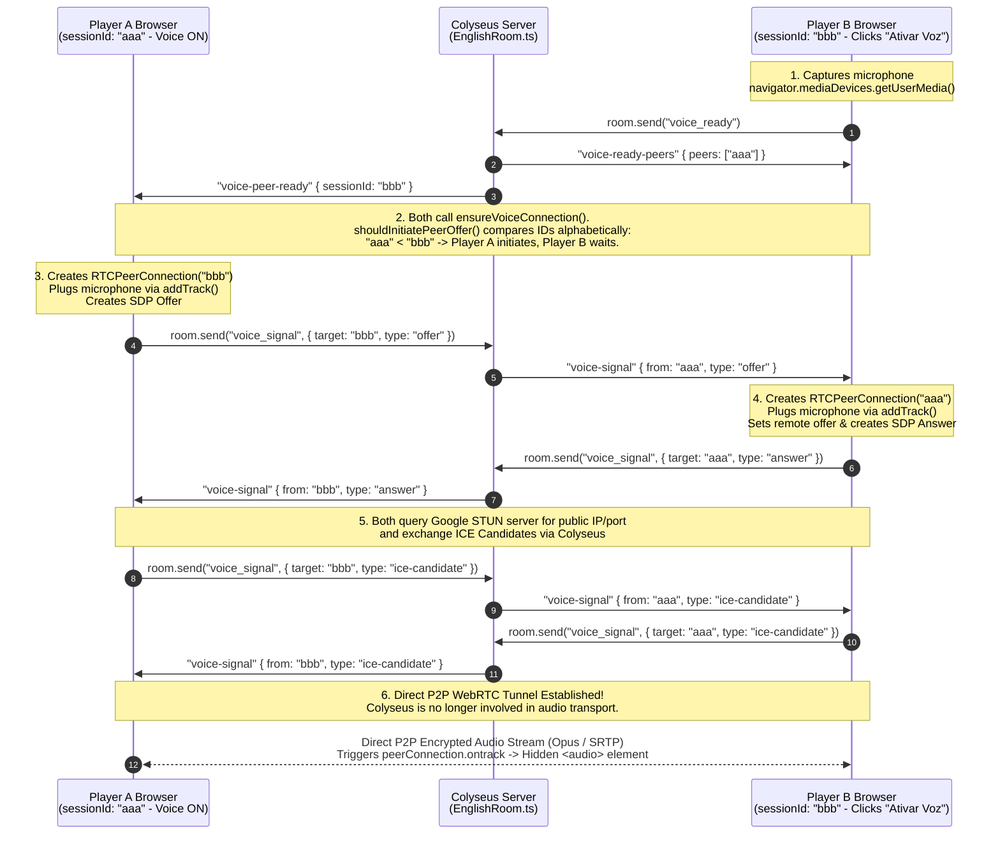

# Complete Guide: How Proximity Voice Chat Works (WebRTC + Colyseus WebSocket)

This document provides a complete, step-by-step explanation of how the **Proximity Voice Chat** system works in this project, from the moment a player's microphone is captured in the browser to how audio streams directly to other players and fades with 3D distance.

---

## 1. High-Level Architecture

The voice chat combines three distinct mechanisms:

1. **Local Audio Capture (`MediaDevices.getUserMedia`)**: Captures the player's physical microphone in the browser with built-in audio processing (`echoCancellation`, `noiseSuppression`, `autoGainControl`).
2. **WebSocket Signaling (`Colyseus` / `EnglishRoom`)**: Acts as the "phonebook/operator" (like sending a text message to coordinate a phone call). The Colyseus server **never processes or relays voice audio bytes**; it only relays lightweight JSON signaling messages (`voice_ready`, `voice_disabled`, `voice_signal`) so browsers can find each other.
3. **Peer-to-Peer Audio Streaming & Spatial Volume (`WebRTC` + 3D Proximity)**: Once two browsers exchange connection details via Colyseus, they open a direct **WebRTC (`RTCPeerConnection`)** tunnel between each other. Every `100ms`, the receiving browser adjusts the volume of each remote player's hidden `<audio>` element based on the 3D distance between their cubes on the `XZ` plane.

### Architecture & Signaling Sequence Diagram



---

## 2. File Structure Overview

| File | Responsibility |
| :--- | :--- |
| [`frontend/src/pages/Room/components/VoiceChatControls/index.tsx`](../frontend/src/pages/Room/components/VoiceChatControls/index.tsx) | Main React component managing microphone capture, `RTCPeerConnection` lifecycle, Colyseus signaling listeners, hidden `<audio>` elements, and the `100ms` proximity volume loop. |
| [`frontend/src/pages/Room/components/VoiceChatControls/helpers.ts`](../frontend/src/pages/Room/components/VoiceChatControls/helpers.ts) | Pure helper functions: `computeProximityVolume` (quadratic distance falloff) and `shouldInitiatePeerOffer` (alphabetical ID tie-breaker to prevent offer collisions). |
| [`frontend/src/pages/Room/components/VoiceChatControls/consts.ts`](../frontend/src/pages/Room/components/VoiceChatControls/consts.ts) | Constants: `maxVoiceDistance = 14` and `rtcConfiguration` (Google public STUN server `stun:stun.l.google.com:19302`). |
| [`frontend/src/pages/Room/components/VoiceChatControls/types.ts`](../frontend/src/pages/Room/components/VoiceChatControls/types.ts) | TypeScript types for `VoiceChatControlsProps` and `VoiceSignalPayload` (`offer`, `answer`, `ice-candidate`). |
| [`backend/src/colyseus/EnglishRoom.ts`](../backend/src/colyseus/EnglishRoom.ts) | Tracks `voiceReadyClients` (`Set<string>`) and relays `voice_ready`, `voice_disabled`, and `voice_signal` messages between room participants. |

---

## 3. End-to-End Voice Flow: From Microphone Capture to Peer Playback

To make the asynchronous WebRTC handshake easy to follow, let's trace a concrete scenario with **2 players**:
- **Player A (`sessionId: "aaa"`)**: Already in the room with voice enabled.
- **Player B (`sessionId: "bbb"`)**: Just clicked the **"Ativar Voz"** button.

---

### Step 1: Capturing the Microphone Locally (`MediaStream`)

When **Player B** clicks **"Ativar Voz"**, `toggleVoiceChat` in [`VoiceChatControls/index.tsx`](../frontend/src/pages/Room/components/VoiceChatControls/index.tsx) requests microphone access from the browser:

```ts
const stream = await navigator.mediaDevices.getUserMedia({
  audio: {
    echoCancellation: true,
    noiseSuppression: true,
    autoGainControl: true,
  },
});

localStreamRef.current = stream;
voiceEnabledRef.current = true;
setVoiceEnabled(true);
setVoiceStatus('Voz por proximidade ativada.');
room.send('voice_ready');
```

- The browser opens the audio hardware, applies echo cancellation, noise suppression, and auto-gain, and returns a live `MediaStream` containing an audio `MediaStreamTrack`.
- This stream is stored in `localStreamRef.current`. At this exact moment, audio is being captured in local memory, but is not yet being transmitted anywhere.
- Immediately after, Player B notifies the Colyseus WebSocket server via `room.send('voice_ready')`.

---

### Step 2: Peer Discovery via the Colyseus WebSocket Server

When [`EnglishRoom.ts`](../backend/src/colyseus/EnglishRoom.ts) receives `'voice_ready'` from **Player B (`"bbb"`)**:

```ts
this.onMessage("voice_ready", (client) => {
  if (this.voiceReadyClients.has(client.sessionId)) {
    return;
  }

  this.voiceReadyClients.add(client.sessionId);

  client.send("voice-ready-peers", {
    peers: [...this.voiceReadyClients].filter((sessionId) => sessionId !== client.sessionId),
  });

  this.broadcast("voice-peer-ready", { sessionId: client.sessionId }, { except: client });
});
```

1. The server adds `"bbb"` to `this.voiceReadyClients`.
2. It sends `"voice-ready-peers"` directly to **Player B** with `{ peers: ["aaa"] }` ("Here is everyone who already has their mic on").
3. It broadcasts `"voice-peer-ready"` to **Player A** with `{ sessionId: "bbb" }` ("Player B just turned their mic on").

On the frontend, receiving either message triggers `ensureVoiceConnection(peerSessionId)` on **both** Player A's browser and Player B's browser.

---

### Step 3: Deciding Who Calls Whom (Preventing Offer Glare)

Think of WebRTC like a direct phone call. If **Player A** and **Player B** both tried to dial each other at the exact same millisecond, the calls would collide (a problem known in WebRTC as *glare*).

To guarantee that only **one** side dials while the other waits to pick up, `ensureVoiceConnection` uses `shouldInitiatePeerOffer` ([`helpers.ts`](../frontend/src/pages/Room/components/VoiceChatControls/helpers.ts)):

```ts
export const shouldInitiatePeerOffer = (localSessionId: string, peerSessionId: string): boolean => {
  return localSessionId.localeCompare(peerSessionId) < 0;
};
```

- It compares the two `sessionId` strings alphabetically:
  - On **Player B's browser (`"bbb"`)**: `"bbb".localeCompare("aaa") < 0` is `false`. Player B stops right there (`if (!shouldInitiateOffer) return;`) and waits for Player A's call.
  - On **Player A's browser (`"aaa"`)**: `"aaa".localeCompare("bbb") < 0` is `true`. Player A takes the initiative to start the call!

---

### Step 4: Plugging the Microphone (`addTrack`) and Sending the Invite (`offer`)

Because **Player A (`"aaa"`)** is the initiator:

1. **Player A creates the WebRTC connection object** by calling `createPeerConnection("bbb")`:
   ```ts
   const peerConnection = new RTCPeerConnection(rtcConfiguration);

   if (localStreamRef.current) {
     localStreamRef.current.getTracks().forEach((track) => {
       peerConnection.addTrack(track, localStreamRef.current as MediaStream);
     });
   }
   ```
   > **Crucial step (`addTrack`)**: This is where Player A's microphone (`localStreamRef.current`) is physically plugged into the connection for Player B. It tells the browser's WebRTC engine: *"Once this tunnel to Player B is open, encode and stream audio from my microphone track into it."*

2. **Player A generates and sends an SDP `offer`**:
   ```ts
   const offer = await peerConnection.createOffer();
   await peerConnection.setLocalDescription(offer);

   sendVoiceSignal(peerSessionId, {
     type: 'offer',
     sdp: offer,
   });
   ```
   - What is an `offer`? It is a small text description (SDP — Session Description Protocol) stating: *"Hi Player B, I want to open a two-way audio channel with you using the Opus audio codec and SRTP encryption. Do you accept?"*
   - Since Player A doesn't have a direct connection to Player B yet, `sendVoiceSignal` sends this `offer` through the Colyseus WebSocket server (`room.send('voice_signal', ...)`), which forwards it to Player B.

---

### Step 5: Accepting the Invite (`answer`) and Plugging Player B's Microphone

**Player B (`"bbb"`)** receives the `'voice-signal'` message from Colyseus and runs `handleVoiceSignal`:

```ts
const peerConnection = createPeerConnection(peerSessionId);

if (payload.type === 'offer') {
  await peerConnection.setRemoteDescription(payload.sdp);

  const answer = await peerConnection.createAnswer();
  await peerConnection.setLocalDescription(answer);

  sendVoiceSignal(peerSessionId, {
    type: 'answer',
    sdp: answer,
  });
  return;
}
```

1. Calling `createPeerConnection("aaa")` creates Player B's end of the `RTCPeerConnection` and **plugs Player B's microphone into it via `addTrack`**.
2. `setRemoteDescription(payload.sdp)` saves Player A's invite.
3. `createAnswer()` generates Player B's confirmation (`answer`), saves it locally (`setLocalDescription`), and sends it back to Player A via Colyseus.
4. When **Player A** receives the `answer`, Player A runs `await peerConnection.setRemoteDescription(payload.sdp)`. Now both browsers agree on the audio format and encryption!

---

### Step 6: Exchanging Network Addresses (`ice-candidate` + STUN)

Now both browsers know *how* they will talk, but they still need to know *where* on the internet to send the UDP audio packets (since most players are behind home routers/NATs).

1. When `new RTCPeerConnection(rtcConfiguration)` was created, it was given Google's public STUN server ([`consts.ts`](../frontend/src/pages/Room/components/VoiceChatControls/consts.ts)):
   ```ts
   export const rtcConfiguration: RTCConfiguration = {
     iceServers: [{ urls: 'stun:stun.l.google.com:19302' }],
   };
   ```
2. Behind the scenes, both browsers ask the STUN server: *"What is my public IP address and port?"*
3. Every time a browser discovers a network path (called an **ICE Candidate**), its `peerConnection.onicecandidate` callback fires automatically:
   ```ts
   peerConnection.onicecandidate = (event) => {
     if (!event.candidate) {
       return;
     }

     sendVoiceSignal(peerSessionId, {
       type: 'ice-candidate',
       candidate: event.candidate.toJSON(),
     });
   };
   ```
4. The candidate is forwarded through Colyseus to the other player, who registers it in `handleVoiceSignal`:
   ```ts
   if (payload.type === 'ice-candidate') {
     await peerConnection.addIceCandidate(payload.candidate);
   }
   ```

---

### Step 7: Direct P2P Audio Streaming & Playback (`ontrack`)

As soon as a matching pair of ICE candidates connects **Player A** and **Player B**:

1. **The direct P2P tunnel opens.** The Colyseus server is completely out of the loop. Each browser continuously encodes its microphone audio, encrypts it, and streams it directly to the other player's browser. (If there are 5 voice-enabled players in a room, each browser maintains 4 `RTCPeerConnection` instances in `peerConnectionsRef`).
2. **Receiving the remote voice stream (`ontrack`)**: When Player A's audio stream arrives at Player B's browser (and vice versa), `peerConnection.ontrack` fires:
   ```ts
   peerConnection.ontrack = (event) => {
     const [remoteStream] = event.streams;
     const audioElement = ensureRemoteAudioElement(peerSessionId);

     if (audioElement.srcObject !== remoteStream) {
       audioElement.srcObject = remoteStream;
     }

     void audioElement.play().catch(() => {
       setVoiceStatus('Clique em ativar voz para liberar o audio do navegador.');
     });
   };
   ```
3. `ensureRemoteAudioElement(peerSessionId)` creates a hidden `<audio autoplay playsinline style="display: none">` tag in `document.body` dedicated to that specific peer, attaches the incoming WebRTC `remoteStream` to `audioElement.srcObject`, and starts playback!

---

## 4. How 3D Proximity Volume Works

Notice that every player transmits their microphone audio at **100% volume**. Volume attenuation is calculated independently by **each receiving browser** based on how far apart the 3D cubes are.

1. **The 100ms Volume Update Loop**:
   In [`VoiceChatControls/index.tsx`](../frontend/src/pages/Room/components/VoiceChatControls/index.tsx), a `window.setInterval` runs every `100ms` (10 times per second) and calls `updateRemoteAudioVolumes()`:
   ```ts
   const updateRemoteAudioVolumes = useCallback(() => {
     const localSessionId = sessionIdRef.current;
     if (!localSessionId) return;

     const localPlayer = playersRef.current[localSessionId];
     if (!localPlayer) return;

     for (const [peerSessionId, audioElement] of remoteAudioElementsRef.current.entries()) {
       const remotePlayer = playersRef.current[peerSessionId];
       audioElement.volume = computeProximityVolume(localPlayer, remotePlayer);
     }
   }, []);
   ```

2. **Quadratic Distance Falloff (`computeProximityVolume`)**:
   In [`VoiceChatControls/helpers.ts`](../frontend/src/pages/Room/components/VoiceChatControls/helpers.ts), the horizontal distance on the `XZ` plane between the local cube and the remote player's cube is converted into a volume between `0.0` and `1.0`:
   ```ts
   export const computeProximityVolume = (localPlayer: Player, remotePlayer?: Player): number => {
     if (!remotePlayer) {
       return 0;
     }

     const dx = remotePlayer.x - localPlayer.x;
     const dz = remotePlayer.z - localPlayer.z;
     const distance = Math.hypot(dx, dz);
     const ratio = Math.max(0, 1 - distance / maxVoiceDistance);

     return ratio * ratio;
   };
   ```
   - `maxVoiceDistance` is `14` units ([`consts.ts`](../frontend/src/pages/Room/components/VoiceChatControls/consts.ts)).
   - Squaring `ratio` (`ratio * ratio`) creates a smooth, natural acoustic falloff:
     - **Distance = `0` units**: `volume = 1.0` (100% volume)
     - **Distance = `7` units (halfway)**: `ratio = 0.5` $\rightarrow$ `volume = 0.25` (25% volume)
     - **Distance $\ge$ `14` units**: `ratio = 0` $\rightarrow$ `volume = 0.0` (completely muted)

---

## 5. Disconnection & Cleanup Lifecycle

Connections and `<audio>` DOM elements are automatically cleaned up in four scenarios:

1. **Local Player Disables Voice**: Clicking **"Desativar Voz"** sends `room.send('voice_disabled')` and runs `resetVoiceState()`, which stops all local microphone tracks (`track.stop()`), closes all `RTCPeerConnection`s, and removes all hidden `<audio>` elements from `document.body`.
2. **Remote Player Disables Voice (`voice-peer-disabled`)**: When another player clicks **"Desativar Voz"**, the server broadcasts `'voice-peer-disabled'`, and all other browsers call `closeVoiceConnection(peerSessionId)` to close that specific `RTCPeerConnection` and remove their `<audio>` tag.
3. **Remote Player Leaves the Room (`voice-peer-left` / `players` state change)**: When a player disconnects from Colyseus, `onLeave` broadcasts `'voice-peer-left'` and removes the player from `state.players`. Both listeners invoke `closeVoiceConnection(peerSessionId)`.
4. **WebRTC Connection Failure**: If `peerConnection.onconnectionstatechange` reports `'failed'` or `'closed'`, `closeVoiceConnection(peerSessionId)` automatically cleans up the stale connection and audio element.
